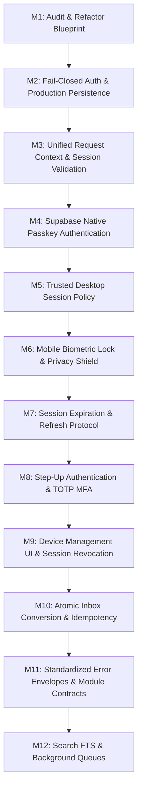

# Personal OS — Architecture Refactor & Security Hardening Plan

> **Specification Standard:** Antigravity Global Engineering System  
> **Target Version:** Next.js 16 (Turbopack, React 19, Tailwind CSS v4) + Supabase SSR / Postgres  
> **Auth & Session Target:** WebAuthn / Passkeys, Device-Aware Session Policy, Fail-Closed Security  
> **Status:** Active Engineering Plan — Milestone 1 (M1 Audit Complete)

---

## 1. Executive Summary & Defect Scorecard

An architectural assessment of Personal OS scored the system at **6.5 / 10** overall and **4 / 10** on production-readiness of core request and data paths. While the modular-monolith structure and domain separation provide a strong foundation, critical security, persistence, and transactional defects must be resolved before the workstation can be considered production-grade.

### P0 Critical Security & Correctness Defects

| # | Defect | File Location | Impact | Architectural Resolution |
|---|--------|---------------|--------|--------------------------|
| **1** | **Fail-Open Development Authentication** | `src/lib/supabase/auth.ts` | `getAuthenticatedUser()` unconditionally falls back to `DEFAULT_DEV_USER_ID` (`00000000-0000-0000-0000-000000000001`) in production, and accepts arbitrary `x-test-user-id` headers without checking `process.env.NODE_ENV === "test"`. Any unauthenticated request gets full access to dev data or can impersonate any user. | Enforce **fail-closed authentication**. Test headers and dev identities are restricted strictly to `NODE_ENV === "test"` and `NODE_ENV === "development"`. In production, absence of a verified Supabase session returns `null` (HTTP 401). |
| **2** | **Silent In-Memory Persistence Fallback** | `src/lib/supabase/server.ts`, `src/modules/*/repository.ts` | When Supabase configuration is missing or client creation fails, repository factories (`getTaskRepository(client)`, etc.) silently fall back to global in-memory singletons. Server restarts or serverless function recycling results in silent data loss. | Make production **fail fast** if Supabase configuration or client is absent. In-memory repositories are isolated to `NODE_ENV === "test"` or explicit mock fixtures. |
| **3** | **Non-Transactional Inbox Conversion & Ghost Entities** | `src/modules/inbox/inbox.service.ts`, `src/app/api/v1/inbox/[id]/process/route.ts` | Task creation and inbox item status update are performed sequentially without a transaction. If step 2 fails, retries cause duplicate tasks. Furthermore, unsupported target types (`note`, `project`, `event`) generate random UUIDs without creating real records, destroying user intent. | Implement an atomic, transactional use case (`ProcessInboxItem`) with idempotency protection. Restrict conversion targets strictly to implemented entities. Unsupported types fail with HTTP 400. |

### P1 Architectural Inconsistencies

| # | Defect | File Location | Impact | Architectural Resolution |
|---|--------|---------------|--------|--------------------------|
| **4** | **Duplicated Supabase Client Instantiation** | `src/app/api/v1/*/route.ts` | Route handlers call `getAuthenticatedUser(req)` (which instantiates a server client) and then immediately call `createClient()` again to construct services. | Introduce unified `RequestContext` via `getRequestContext(request)` that validates auth and returns `{ user, supabase }` in a single pass. |
| **5** | **Database Failure Masked as 404 Not Found** | `src/modules/*/repository.ts` | `findById()` and `update()` return `null` on Supabase errors, masking infrastructure failures as missing resources. | Differentiate infrastructure/network errors from record non-existence. Throw typed `InfrastructureError` on query failures; return `null` only when query succeeds with no matching rows. |
| **6** | **Unsafe Inbox Batch Loop & Broad Exception Catching** | `src/app/api/v1/inbox/batch/route.ts` | Batch route executes loops directly against repositories without task service validation or atomicity policy, and catches all errors into HTTP 400 Bad Request. | Move batch capture into a dedicated application use case with explicit atomicity policy (all-or-nothing or per-item status envelopes) and standard error mapping. |
| **7** | **Hardcoded Auth Token Cookie Cleared on Sign Out** | `src/app/api/v1/auth/me/route.ts` | Sign-out deletes a hardcoded cookie name (`sb-yvdzdwzfgozeanwusysh-auth-token`) instead of executing `supabase.auth.signOut()`. | Replace manual cookie deletion with server-side `supabase.auth.signOut()` using the request-scoped client. |

---

## 2. Five-Layer Architecture Blueprint

Personal OS adheres to a strict five-layer modular monolith:

```
+--------------------------------------------------------------------------+
| 1. EXPERIENCE LAYER                                                      |
|    - Next.js Pages & Layouts (App Router)                                |
|    - Client Components (React 19, Tailwind CSS v4, Radix UI primitives)  |
|    - Shared UI & Brand System (Warm editorial tokens, AppOrb)            |
+--------------------------------------------------------------------------+
                                    |
                                    v
+--------------------------------------------------------------------------+
| 2. API & REQUEST BOUNDARY                                                |
|    - Route Handlers (/api/v1/*)                                          |
|    - Request Context (Single-pass auth, scoped Supabase client)          |
|    - Zod Validation, DTO Parsing & Uniform Response Envelopes            |
|    - Standard HTTP Error Status Mapping (401, 403, 404, 409, 422, 500)   |
+--------------------------------------------------------------------------+
                                    |
                                    v
+--------------------------------------------------------------------------+
| 3. APPLICATION LAYER                                                     |
|    - Use Cases & Commands (e.g. ProcessInboxItem, BatchIngestTasks)      |
|    - Composed Read Models (e.g. GetMyDayOverview, GetDashboardMetrics)   |
|    - Cross-Module Orchestration & Transaction Boundaries                 |
+--------------------------------------------------------------------------+
                                    |
                                    v
+--------------------------------------------------------------------------+
| 4. DOMAIN MODULES                                                        |
|    - Domain Entities, Value Objects & Invariants                         |
|    - Module Services (TaskService, HabitService, NoteService)            |
|    - Strict Ownership: Modules do not import peer private repositories   |
+--------------------------------------------------------------------------+
                                    |
                                    v
+--------------------------------------------------------------------------+
| 5. INFRASTRUCTURE LAYER                                                  |
|    - Repository Interfaces & Supabase Postgres Adapters                  |
|    - PostgreSQL Row-Level Security (RLS) enforcement                     |
|    - PostgreSQL Transaction RPCs (process_inbox_item_to_task)            |
|    - Background Execution & Scheduled Workers (Supabase Queues / Cron)  |
+--------------------------------------------------------------------------+
```

### Layer Responsibility Matrix

1. **Experience Layer:** Renders UI, receives user interactions, invokes server actions or API endpoints. Does not contain business logic or direct database queries.
2. **API Layer:** Validates HTTP protocol, verifies authentication session via `RequestContext`, parses and validates payloads with Zod, dispatches to application use cases or domain services, and serializes responses into standardized envelopes (`apiSuccess`, `apiError`).
3. **Application Layer:** Coordinates workflows spanning multiple domains, manages transactions, enforces idempotency, and composes multi-module read models (`My Day`, `Dashboard`).
4. **Domain Layer:** Pure business logic, invariants, and domain rules (e.g. habit streak calculation, task recurrence rules, markdown link extraction). Zero dependencies on Next.js, HTTP, or Supabase SDKs.
5. **Infrastructure Layer:** Implements repository interfaces against Supabase PostgreSQL, executes atomic stored procedures, and manages cookies/sessions via `@supabase/ssr`.

---

## 3. Module Boundaries & Data Ownership

To prevent state fragmentation and conflicting sources of truth:

| Module | Owns Database Entities | Public Contract (Exposed To Peers) | Private (Restricted) |
|---|---|---|---|
| **Tasks** (`/tasks`) | `tasks`, `task_lists` | `ITaskService` commands & queries | `ITaskRepository`, table schemas |
| **Inbox** (`/inbox`) | `inbox_items` | `IInboxService` capture & triage | `IInboxRepository` |
| **Projects** (`/projects`) | `projects`, `project_milestones` | `IProjectService` progress & status | `IProjectRepository` |
| **Calendar** (`/calendar`) | `calendar_events` | `ICalendarService` event booking | `ICalendarRepository` |
| **Focus** (`/focus`) | `focus_sessions` | `IFocusService` timer & state machine | `IFocusRepository` |
| **Notes** (`/notes`) | `notes`, `note_links` | `INoteService` wiki linking & search | `INoteRepository` |
| **Habits** (`/habits`) | `habits`, `habit_logs` | `IHabitService` daily check-ins & streaks | `IHabitRepository` |
| **Journal** (`/journal`) | `journal_entries` | `IJournalService` reflections & mood | `IJournalRepository` |
| **Search** (`/search`) | Search index / FTS | Cross-module search query service | Underlying indexing mechanics |
| **My Day** (`/`) | *None (Composed Read Model)* | `GetMyDayOverview` query | N/A |
| **Dashboard** (`/`) | *None (Composed Read Model)* | `GetDashboardSummary` query | N/A |

**Cross-Module Rule:** Modules must never import or query another module's repository directly. Cross-module operations (e.g. converting an inbox item to a task) must go through an Application Use Case (`ProcessInboxItem`).

---

## 4. Device-Aware Authentication & Session Architecture

### 4.1 Native Supabase Passkeys & WebAuthn

Personal OS leverages native `@supabase/supabase-js` v2.119+ WebAuthn passkey capabilities:
- **Sign-In:** `supabase.auth.signInWithPasskey()` initiates the WebAuthn challenge, prompts the platform authenticator (Touch ID, Face ID, Windows Hello, or hardware security key), and verifies the signed assertion against Supabase Auth.
- **Registration:** `supabase.auth.registerPasskey()` registers a new passkey credential linked to the authenticated user account.
- **Management:** `supabase.auth.passkey.list()`, `update()`, and `delete()` provide full credential lifecycle control.

### 4.2 Desktop Session Policy
- **Initial Enrollment:** Sign in via Passkey or Password. Optional "Remember this trusted device" checkbox.
- **Session Storage:** Secure server-readable cookies managed through `@supabase/ssr` with `HttpOnly`, `Secure`, and `SameSite=Lax`. No tokens in `localStorage`.
- **Inactivity Timeout:** 3 hours of server-side inactivity triggers session revocation.
- **Absolute Lifetime:** 12 hours absolute maximum session duration.
- **Revocation:** Explicit sign out invalidates the server session (`supabase.auth.signOut({ scope: 'local' | 'others' | 'global' })`).

### 4.3 Mobile Session & Biometric Policy
- **Platform Authenticator:** WebAuthn platform authenticator verification in mobile Safari, Chrome, and PWA mode.
- **Background Privacy Shield:** When the browser tab or PWA is backgrounded, the UI immediately displays a blurred privacy screen.
- **Lock Grace Period:** 60 seconds grace period. Returning after 60 seconds requires biometric prompt (Face ID / Fingerprint / Device PIN) before revealing interface content.
- **Zero Storage of Biometrics:** Biometric authentication remains strictly within the device's Secure Enclave; no biometric signatures or raw data are ever transmitted or stored.

### 4.4 Step-Up Authentication
High-impact operations require recent (< 5 minutes) re-verification:
- Enrolling or deleting passkeys.
- Enrolling or disabling TOTP MFA.
- Revoking devices or active sessions.
- Exporting or permanently deleting account data.

---

## 5. Transactional Workflows & Persistence Durability

### 5.1 Atomic Inbox Conversion (`ProcessInboxItem`)
To eliminate the race condition where a task is created but the inbox item remains unprocessed:
1. **PostgreSQL Stored Procedure:** Implement migration `0011_inbox_atomic_process.sql` creating function `public.process_inbox_item_to_task(p_item_id UUID, p_user_id UUID, p_priority TEXT, p_due_date DATE, p_project_id UUID, p_idempotency_key UUID)`.
2. **Atomicity:** The function validates item ownership, inserts the task, updates the inbox item with `status = 'processed'`, `converted_entity_type = 'task'`, `converted_entity_id = <task_id>`, and commits atomically.
3. **Idempotency:** If the inbox item is already processed or the idempotency key matches an existing conversion, it returns the existing task ID without creating a duplicate.
4. **Scope Restriction:** The UI and API support only currently implemented conversion targets (`task`). Selecting non-implemented types returns a clear `400 VALIDATION_ERROR` rather than a fake UUID.

### 5.2 Safe Batch Ingestion
- `parseBatchIngest()` results are passed to `BatchIngestTasksUseCase`.
- Explicit atomicity policy: Returns a structured response containing individual item outcomes (`succeeded: Task[]`, `failed: { index: number, reason: string }[]`).
- Validation occurs before writing to prevent partial corrupt state.

---

## 6. Detailed Milestone Implementation Roadmap



### Milestone Breakdown

#### Milestone 1: Audit Authentication, Session Handling, and Repository Fallbacks (CURRENT)
- [x] Complete security audit of `auth.ts`, `server.ts`, `middleware.ts`, route handlers, and 12 repository files.
- [x] Identify P0 fail-open development auth, silent in-memory fallback, and non-transactional inbox conversion defects.
- [x] Verify Supabase JS v2.119+ passkey and WebAuthn capability.
- [x] Author comprehensive `ARCHITECTURE_REFACTOR_PLAN.md`.
- [x] Deliver Milestone 1 Completion Report.

#### Milestone 2: Fix Fail-Closed Authentication and Production Persistence Behavior
- **Files to Modify:**
  - `src/lib/supabase/auth.ts`: Make authentication fail-closed. Remove unrestricted `x-test-user-id` header support (gate behind `process.env.NODE_ENV === "test"` only). Remove unconditional `DEFAULT_DEV_USER_ID` fallback in production. Return `null` when no verified Supabase user exists.
  - `src/lib/supabase/server.ts`: Throw `ConfigurationError` in production if `NEXT_PUBLIC_SUPABASE_URL` or `NEXT_PUBLIC_SUPABASE_ANON_KEY` is missing.
  - `src/modules/*/repository.ts` (all 12 modules): Replace silent fallback to `globalInMemory*Repo` with fail-fast exception when `client` is null in production.
- **Tests to Add:**
  - `src/lib/supabase/auth.test.ts`: Verify unauthenticated requests return `null` in production; verify `x-test-user-id` is rejected when `NODE_ENV !== "test"`.
  - `src/lib/supabase/server.test.ts`: Verify missing environment variables trigger fail-fast errors in production.
  - Repository factory tests verifying persistence fail-fast in production mode.

#### Milestone 3: Implement Consistent Request Context and Session Handling
- **Files to Create / Modify:**
  - `src/lib/supabase/context.ts`: Create `getRequestContext(request: Request)` returning `{ user: AuthenticatedUser, supabase: SupabaseClient }`.
  - Refactor all `/api/v1/*` routes to obtain `{ user, supabase }` via `getRequestContext(request)` in a single pass, eliminating double client creation.
  - Update `src/lib/supabase/middleware.ts` to ensure consistent session cookie forwarding and CSRF protection.
- **Tests to Add:**
  - Context unit tests verifying single-pass client creation, user verification, and cookie propagation.

#### Milestone 4: Configure and Test Supabase Passkey Authentication
- **Files to Create / Modify:**
  - `src/lib/auth/passkeys.ts`: Helper methods for `signInWithPasskey()` and `registerPasskey()`.
  - `src/app/login/page.tsx`: Add "Sign in with Passkey / Biometrics" with WebAuthn browser detection and fallback.
  - `src/components/auth/PasskeyButton.tsx`: Reusable passkey ceremony trigger.
- **Tests to Add:**
  - Unit and integration tests mocking WebAuthn ceremonies and testing failure fallbacks.

#### Milestone 5: Implement Remembered Desktop Sessions
- **Files to Create / Modify:**
  - `src/lib/auth/session-policy.ts`: Manage trusted-device flag, inactivity timestamps, and absolute lifetime.
  - Route handlers and middleware updating last-activity timestamp in secure cookies.
- **Tests to Add:**
  - Session lifetime and idle expiration tests.

#### Milestone 6: Implement Mobile Passkey Reauthentication and App Locking
- **Files to Create / Modify:**
  - `src/components/auth/AppLockScreen.tsx`: Background blur shield and lock overlay.
  - `src/lib/hooks/useAppLock.ts`: Detect `visibilitychange` and window blur, track background duration, enforce 60-second grace period.
- **Tests to Add:**
  - Hook tests verifying grace period transitions and reauthentication triggers.

#### Milestone 7: Configure and Test Inactivity and Absolute Expiration Policies
- **Files to Create / Modify:**
  - Server-side session verification rejecting requests after 3 hours of inactivity or 12 hours total session duration.
  - Client-side session expiration warning modal.
- **Tests to Add:**
  - Edge-case testing for expired JWTs, failed refresh attempts, and forced redirects to `/login`.

#### Milestone 8: Add Optional TOTP MFA and Recovery Flows
- **Files to Create / Modify:**
  - `src/lib/auth/mfa.ts`: Supabase MFA enrollment (`supabase.auth.mfa.enroll`), challenge, and verification.
  - `src/components/settings/TotpEnrollmentModal.tsx`: QR code display and backup recovery codes.
- **Tests to Add:**
  - MFA challenge and assurance level tests (`aal1` vs `aal2`).

#### Milestone 9: Build Device Management UI and Revocation
- **Files to Create / Modify:**
  - `src/app/settings/security/page.tsx` & `src/components/settings/SecurityDevicesView.tsx`: View active sessions, registered passkeys, and trusted devices.
  - API endpoint `/api/v1/auth/sessions/revoke`: Server-side session invalidation via `supabase.auth.admin.signOut()` or scoped sign out.
- **Tests to Add:**
  - Session revocation and cross-device sign-out tests.

#### Milestone 10: Correct Inbox Transaction and Idempotency Behavior
- **Files to Create / Modify:**
  - `db/migrations/0011_inbox_atomic_process.sql`: PostgreSQL function `process_inbox_item_to_task`.
  - `src/modules/inbox/use-cases/ProcessInboxItem.ts`: Atomic application use case with idempotency key.
  - `src/app/api/v1/inbox/[id]/process/route.ts`: Updated route delegating to use case.
  - `src/app/api/v1/inbox/batch/route.ts`: Refactor to use structured batch use case.
- **Tests to Add:**
  - Transaction rollback tests (verifying no orphaned task if inbox update fails).
  - Idempotency verification tests.

#### Milestone 11: Standardize Module Contracts and Error Handling
- **Files to Create / Modify:**
  - `src/lib/api/response.ts`: Add `apiForbidden`, `apiConflict`, `apiInternalError`, `apiValidationError`.
  - `src/lib/api/errorHandler.ts`: Map domain and infrastructure errors to standard HTTP status codes without leaking internals.
  - Standardize all module boundaries.
- **Tests to Add:**
  - API error mapping tests across all route handlers.

#### Milestone 12: Implement Remaining Architecture Improvements Incrementally
- **Files to Create / Modify:**
  - PostgreSQL full-text search indexing (`0012_search_fts.sql`) for notes, tasks, projects, journal.
  - Supabase Queues (pgmq) integration for background jobs.
  - Update Graphify knowledge graph (`graphify run`).

---

## 7. Security Test Matrix

| Test Suite | Scenario | Expected Outcome | Milestone |
|---|---|---|---|
| **Auth Fail-Closed** | Unauthenticated request to `/api/v1/tasks` with no session cookie | HTTP 401 `UNAUTHORIZED` | M2 |
| **Header Impersonation** | Request with `x-test-user-id: 00000000-...` when `NODE_ENV === "production"` | Header ignored; HTTP 401 | M2 |
| **Production Persistence** | App started without Supabase credentials in production | Throws `ConfigurationError`; fails fast | M2 |
| **Single-Pass Context** | Route execution via `getRequestContext()` | Exactly 1 Supabase client created per request | M3 |
| **Passkey Ceremony** | Valid WebAuthn assertion submitted to `signInWithPasskey` | Session created; HTTP 200 | M4 |
| **Passkey Fallback** | User cancels WebAuthn prompt or platform lacks authenticator | Clean fallback to password / recovery | M4 |
| **Idle Expiration** | Session inactive for > 3 hours | Server rejects request with HTTP 401 | M7 |
| **Absolute Expiration** | Session active for > 12 hours | Server forces re-authentication | M7 |
| **Step-Up Verification** | Deleting passkey without recent auth challenge | HTTP 403 `STEP_UP_REQUIRED` | M8 |
| **Device Revocation** | User revokes device session from Settings | Immediate 401 on revoked device | M9 |
| **Atomic Inbox Triage** | Task creation succeeds but inbox status update encounters error | PostgreSQL rolls back task creation; no orphan | M10 |
| **Idempotent Triage** | Same inbox conversion request submitted twice with same key | Returns existing task ID; no duplicate created | M10 |

---

## 8. Production Readiness Gates

Before any production deployment, the system must pass these four gates:
1. **Security Gate:** Zero fail-open fallback paths; all test headers disabled outside `NODE_ENV === "test"`; all tables covered by verified RLS policies.
2. **Durability Gate:** Zero runtime in-memory database fallbacks; all transactions verified against PostgreSQL.
3. **Identity Gate:** WebAuthn passkey and remembered session policies functional across desktop and mobile browsers.
4. **Verification Gate:** 100% of test suites passing (unit, API integration, security tests) with zero TypeScript emit errors.
