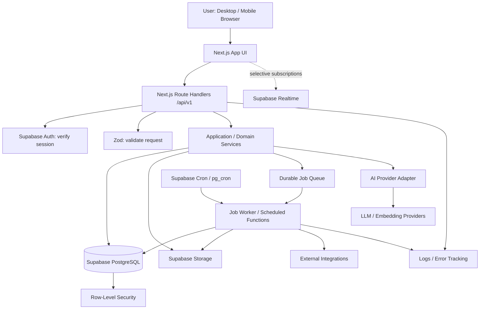
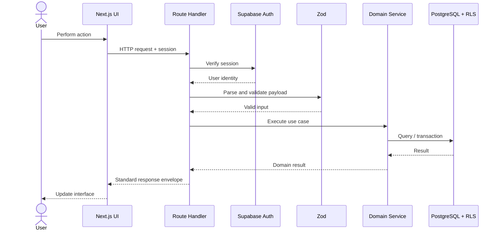
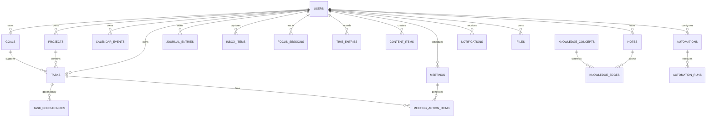
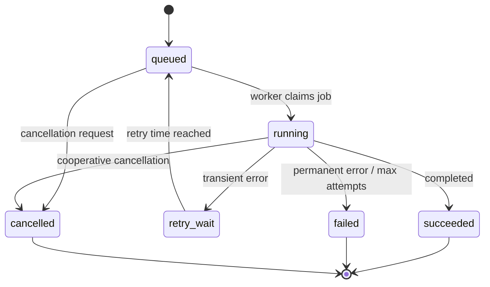
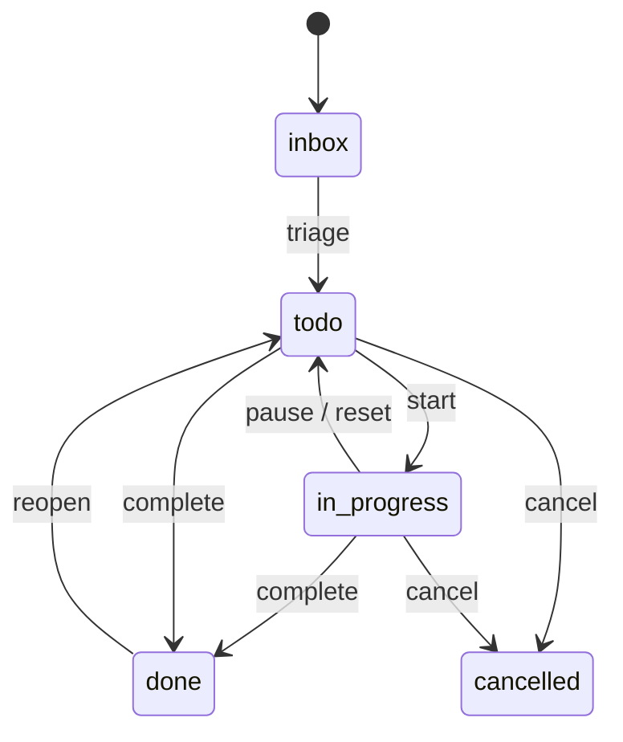

# Personal OS — Backend Architecture & API Specification

**Document type:** Technical reference  
**Status:** Proposed baseline  
**Purpose:** Canonical backend guide for agent-driven implementation with Antigravity and Graphify.

> This specification describes the backend for the Personal Productivity OS. The initial product is a productivity application; AI capabilities are introduced as modular layers rather than making the core app dependent on AI.

---

## 1. Architecture decisions

| Area | Baseline decision | Rationale |
|---|---|---|
| Application | Modular monolith | Keeps deployment and operations lightweight while preserving module boundaries |
| Frontend | Next.js App Router + React + TypeScript | Product UI, server rendering where useful, typed client |
| Backend API | Next.js Route Handlers (`/api/v1`) | Same deployable app; clear HTTP contracts |
| Primary database | Supabase PostgreSQL | Relational data, transactions, constraints, managed operations |
| Authentication | Supabase Auth | Identity, sessions, OAuth support |
| Authorization | PostgreSQL Row-Level Security (RLS) | Enforce user ownership at the data layer |
| Validation | Zod schemas | Runtime validation and shared API contracts |
| ORM/query access | Supabase JS for RLS-bound user operations; SQL migrations for schema and advanced queries | Avoid unnecessary ORM complexity; keep DB features explicit |
| Vector search | pgvector in PostgreSQL | Keep embeddings near source records; avoid separate vector service initially |
| File storage | Supabase Storage | Private file objects with policy-controlled access |
| Realtime | Supabase Realtime, selectively | Only subscribe to features needing live updates |
| Scheduled tasks | Supabase Cron / `pg_cron` where supported | Simple scheduled maintenance and reminders |
| Durable jobs | PostgreSQL-backed queue (e.g. Supabase Queues/pgmq, if enabled) | Retryable background work without introducing Redis early |
| AI provider integration | Server-side provider adapter | Keep model vendors replaceable |
| Observability | Structured logs, error tracking, job logs, basic metrics | Diagnose failures and operational issues |

### Core principles

1. Core productivity functions must work without an AI provider.
2. Every user-owned record has explicit ownership and RLS protection.
3. APIs validate input, authenticate identity, authorize access, and return consistent envelopes.
4. Database constraints are the final guard against invalid persisted state.
5. Use asynchronous jobs for work that is slow, retryable, scheduled, or external.
6. Do not introduce microservices, Redis, GraphQL, or a separate vector database without a demonstrated need.
7. Keep integrations and AI provider-specific code behind adapters.

---

## 2. System architecture



### Request lifecycle



---

## 3. Module boundaries

Each domain module should own its service logic, schemas, repository/query functions, and API handlers.

```text
src/
  app/
    api/v1/
      dashboard/
      tasks/
      projects/
      goals/
      calendar/
      focus/
      notes/
      journal/
      inbox/
      meetings/
      content/
      knowledge/
      search/
      analytics/
      automations/
      notifications/
      settings/
      integrations/
      files/
  modules/
    auth/
    dashboard/
    tasks/
    projects/
    goals/
    calendar/
    focus/
    notes/
    journal/
    inbox/
    meetings/
    content/
    knowledge/
    ai/
    search/
    analytics/
    automations/
    notifications/
    integrations/
    files/
  lib/
    supabase/
    validation/
    api/
    security/
    observability/
  db/
    migrations/
    seeds/
  workers/
    handlers/
    schedules/
```

**Boundary rule:** A module may call another module's public service contract, but should not reach into its private implementation. Cross-module writes that require consistency should be coordinated in one application service and one database transaction.

---

## 4. API conventions

### Base path

`/api/v1`

### Authentication

- Protected endpoints require a valid Supabase session.
- Derive `user_id` from the verified session; never trust a user ID supplied in request JSON.
- Use service-role credentials only in trusted server/worker environments. Never expose them to the browser.
- Public endpoints must be explicitly marked and reviewed.

### Response envelope

Success:

```json
{
  "data": {},
  "meta": {
    "request_id": "uuid"
  }
}
```

Error:

```json
{
  "error": {
    "code": "VALIDATION_ERROR",
    "message": "The request payload is invalid.",
    "details": [],
    "request_id": "uuid"
  }
}
```

### HTTP conventions

| Method | Usage |
|---|---|
| GET | Read resource or collection |
| POST | Create resource or execute a command |
| PATCH | Partial update |
| PUT | Replace resource when semantics are appropriate |
| DELETE | Delete/archive resource |

- Use ISO-8601 timestamps in UTC.
- Use UUIDs for entity identifiers.
- Paginate collections with cursor pagination (`limit`, `cursor`).
- Apply a default page size of 25 and a maximum of 100.
- Use `409 Conflict` for state conflicts and uniqueness conflicts.
- Use `422 Unprocessable Entity` for domain validation failures when distinct from malformed input.
- Use `429 Too Many Requests` for rate limiting.
- Commands that may be retried by clients should accept an `Idempotency-Key`.
- Keep API contracts documented in OpenAPI as they stabilize.

---

## 5. API endpoint inventory

Endpoints below are a proposed contract inventory. Implement only as modules reach their milestone.

### Dashboard and day view

| Method | Endpoint | Purpose |
|---|---|---|
| GET | `/dashboard` | Dashboard summary and widgets |
| GET | `/day?date=YYYY-MM-DD` | Day overview |
| GET | `/day/agenda` | Scheduled items for selected range |
| PATCH | `/dashboard/preferences` | User dashboard layout/preferences |

### Tasks

| Method | Endpoint | Purpose |
|---|---|---|
| GET | `/tasks` | List/filter tasks |
| POST | `/tasks` | Create task |
| GET | `/tasks/:taskId` | Read task |
| PATCH | `/tasks/:taskId` | Update task |
| DELETE | `/tasks/:taskId` | Archive/delete task |
| POST | `/tasks/:taskId/complete` | Complete task |
| POST | `/tasks/:taskId/reopen` | Reopen task |
| POST | `/tasks/reorder` | Reorder within a list |
| POST | `/tasks/bulk` | Bulk update/archive with validated operation |

Suggested filters: `status`, `priority`, `project_id`, `goal_id`, `due_before`, `due_after`, `tag`, `search`, `cursor`, `limit`.

### Projects

| Method | Endpoint | Purpose |
|---|---|---|
| GET | `/projects` | List projects |
| POST | `/projects` | Create project |
| GET | `/projects/:projectId` | Project details |
| PATCH | `/projects/:projectId` | Update project |
| DELETE | `/projects/:projectId` | Archive project |
| GET | `/projects/:projectId/tasks` | Project tasks |
| GET | `/projects/:projectId/activity` | Project activity stream |

### Goals

| Method | Endpoint | Purpose |
|---|---|---|
| GET | `/goals` | List goals |
| POST | `/goals` | Create goal |
| GET | `/goals/:goalId` | Goal details |
| PATCH | `/goals/:goalId` | Update goal |
| POST | `/goals/:goalId/check-ins` | Record progress check-in |
| GET | `/goals/:goalId/check-ins` | Read progress history |

### Calendar and scheduling

| Method | Endpoint | Purpose |
|---|---|---|
| GET | `/calendar/events?from=&to=` | Events in date range |
| POST | `/calendar/events` | Create event |
| GET | `/calendar/events/:eventId` | Event details |
| PATCH | `/calendar/events/:eventId` | Update event |
| DELETE | `/calendar/events/:eventId` | Delete event |
| POST | `/calendar/events/:eventId/move` | Move/reschedule event |
| GET | `/calendar/availability` | User's app-level availability |

External calendar sync should be isolated in integration adapters and background jobs.

### Focus and time tracking

| Method | Endpoint | Purpose |
|---|---|---|
| POST | `/focus/sessions` | Start focus session |
| GET | `/focus/sessions/current` | Get active session |
| POST | `/focus/sessions/:sessionId/pause` | Pause |
| POST | `/focus/sessions/:sessionId/resume` | Resume |
| POST | `/focus/sessions/:sessionId/complete` | Complete |
| GET | `/time-entries` | List time entries |
| POST | `/time-entries` | Create manual time entry |
| PATCH | `/time-entries/:entryId` | Edit time entry |
| DELETE | `/time-entries/:entryId` | Delete time entry |

### Notes, journal, and knowledge

| Method | Endpoint | Purpose |
|---|---|---|
| GET | `/notes` | List notes |
| POST | `/notes` | Create note |
| GET | `/notes/:noteId` | Read note |
| PATCH | `/notes/:noteId` | Update note |
| DELETE | `/notes/:noteId` | Archive note |
| GET | `/journal/entries` | List journal entries |
| POST | `/journal/entries` | Create journal entry |
| GET | `/journal/entries/:entryId` | Read entry |
| PATCH | `/journal/entries/:entryId` | Update entry |
| GET | `/knowledge/concepts` | List concepts |
| POST | `/knowledge/concepts` | Create concept |
| PATCH | `/knowledge/concepts/:conceptId` | Update concept |
| POST | `/knowledge/edges` | Create relationship |
| DELETE | `/knowledge/edges/:edgeId` | Remove relationship |

### Inbox, meetings, and capture

| Method | Endpoint | Purpose |
|---|---|---|
| GET | `/inbox/items` | List captured items |
| POST | `/inbox/items` | Capture item |
| PATCH | `/inbox/items/:itemId` | Update item |
| POST | `/inbox/items/:itemId/process` | Convert item into task/note/etc. |
| POST | `/meetings` | Create meeting |
| GET | `/meetings/:meetingId` | Meeting details |
| PATCH | `/meetings/:meetingId` | Update meeting |
| POST | `/meetings/:meetingId/notes` | Add meeting notes |
| POST | `/meetings/:meetingId/action-items` | Create linked action items |

### Content studio and publishing queue

| Method | Endpoint | Purpose |
|---|---|---|
| GET | `/content/items` | List content |
| POST | `/content/items` | Create content draft |
| GET | `/content/items/:contentId` | Read content |
| PATCH | `/content/items/:contentId` | Update draft |
| POST | `/content/items/:contentId/schedule` | Schedule publication |
| POST | `/content/items/:contentId/cancel-schedule` | Cancel schedule |
| GET | `/content/calendar` | Content calendar |
| POST | `/content/items/:contentId/publish` | Request publication |

Publishing is asynchronous; provider credentials and publishing calls must remain server-side.

### Search, AI, and memory (future layer)

| Method | Endpoint | Purpose |
|---|---|---|
| GET | `/search?q=&scope=` | Search accessible app data |
| POST | `/ai/assist` | Request AI assistance |
| POST | `/ai/threads` | Create AI thread |
| GET | `/ai/threads/:threadId` | Read thread |
| POST | `/ai/threads/:threadId/messages` | Send message |
| GET | `/ai/memories` | List user-approved/managed memories |
| POST | `/ai/memories` | Create memory |
| PATCH | `/ai/memories/:memoryId` | Update memory |
| DELETE | `/ai/memories/:memoryId` | Delete memory |
| POST | `/ai/embeddings/reindex` | Enqueue reindex request (admin/user-scoped) |

AI endpoints should have strict quotas, input/output limits, and explicit context scoping. The AI layer must not bypass domain authorization.

### Analytics and reports

| Method | Endpoint | Purpose |
|---|---|---|
| GET | `/analytics/overview` | Summary metrics |
| GET | `/analytics/tasks` | Task completion trends |
| GET | `/analytics/time` | Time allocation |
| GET | `/analytics/goals` | Goal progress |
| POST | `/reports` | Create report request |
| GET | `/reports/:reportId` | Report status/result |

Large report generation should run asynchronously.

### Automations, jobs, reminders, and notifications

| Method | Endpoint | Purpose |
|---|---|---|
| GET | `/automations` | List user automations |
| POST | `/automations` | Create automation |
| GET | `/automations/:automationId` | Read automation |
| PATCH | `/automations/:automationId` | Update automation |
| POST | `/automations/:automationId/enable` | Enable |
| POST | `/automations/:automationId/disable` | Disable |
| GET | `/automations/:automationId/runs` | Read run history |
| GET | `/jobs/:jobId` | Read job status, scoped to owner |
| GET | `/notifications` | List notifications |
| POST | `/notifications/:notificationId/read` | Mark read |
| POST | `/notifications/read-all` | Mark all read |
| GET | `/reminders` | List reminders |
| POST | `/reminders` | Create reminder |
| PATCH | `/reminders/:reminderId` | Update reminder |
| DELETE | `/reminders/:reminderId` | Delete reminder |

### Settings, integrations, and files

| Method | Endpoint | Purpose |
|---|---|---|
| GET | `/settings/profile` | Read profile/preferences |
| PATCH | `/settings/profile` | Update profile/preferences |
| GET | `/integrations` | List connected integrations |
| POST | `/integrations/:provider/connect` | Begin OAuth connection |
| POST | `/integrations/:provider/callback` | Handle OAuth callback |
| POST | `/integrations/:integrationId/disconnect` | Revoke connection |
| POST | `/files/upload-url` | Create authorized upload URL |
| GET | `/files` | List metadata |
| GET | `/files/:fileId` | Read metadata |
| DELETE | `/files/:fileId` | Delete file and metadata |

---

## 6. Data model and relational schema guidance

The database schema is to be implemented through versioned SQL migrations. Use UUID primary keys, `created_at` and `updated_at` timestamps where appropriate, foreign keys, and indexes aligned to real query patterns.

### Common columns

```sql
id uuid primary key default gen_random_uuid(),
user_id uuid not null references auth.users(id) on delete cascade,
created_at timestamptz not null default now(),
updated_at timestamptz not null default now()
```

Do not add every common column blindly: immutable events and join tables may not need `updated_at`.

### Core entity map



### Core tables (baseline)

| Table | Key fields / notes |
|---|---|
| `profiles` | `id` references auth user; display name, timezone, locale |
| `user_preferences` | User-specific UI and product preferences; JSONB only for flexible settings |
| `projects` | name, description, status, color, start/end dates, archived_at |
| `tasks` | title, description, status, priority, due_at, scheduled_at, project_id, goal_id, parent_task_id, completed_at, position |
| `task_dependencies` | task_id, depends_on_task_id; unique pair; prevent self-dependency |
| `task_tags` | task_id, tag_id; composite unique |
| `tags` | user_id, name; unique normalized name per user |
| `goals` | title, description, status, target_date, metric/unit, target_value |
| `goal_check_ins` | goal_id, recorded_at, value, note |
| `calendar_events` | title, starts_at, ends_at, timezone, event_type, linked entity reference |
| `focus_sessions` | task_id nullable, started_at, ended_at, status, paused duration |
| `time_entries` | task_id/project_id nullable, starts_at, ends_at, duration_seconds, source |
| `notes` | title, body, format, archived_at |
| `journal_entries` | entry_date, body, mood optional, metadata |
| `inbox_items` | capture_type, raw_content, status, processed_entity_type/id |
| `meetings` | title, starts_at, ends_at, participants, notes |
| `meeting_action_items` | meeting_id, task_id, excerpt |
| `content_items` | title, body, channel, status, scheduled_at, published_at |
| `knowledge_concepts` | name, description, source references |
| `knowledge_edges` | source_concept_id, target_concept_id, relation_type |
| `notifications` | type, title, body, read_at, payload |
| `reminders` | target entity, remind_at, status, delivery channel |
| `automations` | name, trigger definition, action definition, enabled |
| `automation_runs` | automation_id, status, started_at, finished_at, error |
| `jobs` / queue tables | job type, payload, status, attempts, run_after, lock data |
| `integration_connections` | provider, encrypted credential reference, scopes, status |
| `files` | storage path, mime type, size, checksum, linked entity |
| `ai_threads` | title, context scope, metadata |
| `ai_messages` | thread_id, role, content, model/provider metadata |
| `ai_memories` | content, category, source, embedding, status |
| `audit_events` | actor, action, entity type/id, metadata, occurred_at |

### Constraints and indexing

- Every user-owned table should include `user_id` and RLS policies.
- Foreign keys must enforce ownership-safe relationships where practical. Avoid cross-user links by validating ownership in service logic and, where appropriate, composite keys/constraints.
- Use `CHECK` constraints for valid status/priority values and nonnegative quantities.
- `ends_at > starts_at` for events and time entries when both exist.
- `completed_at` should align with task completion state.
- Prevent duplicate dependency pairs and self-dependency.
- Use unique constraints for per-user normalized tags and external provider IDs.
- Index common filters: `(user_id, status)`, `(user_id, due_at)`, `(user_id, project_id)`, `(user_id, created_at desc)`.
- Use partial indexes for active/non-archived records where beneficial.
- Index foreign-key columns used for joins.
- Add vector indexes only after embedding dimensions, distance metric, and query patterns are defined.
- Avoid indexing every column; review query plans with realistic data.

### Timezone and date rules

- Store instants in `timestamptz` in UTC.
- Store the user's IANA timezone in profile/preferences.
- All-day calendar events should use date semantics, not midnight UTC as a proxy.
- Recurring schedule definitions should preserve local timezone and recurrence rules.
- Calculate display dates in the client/user timezone; calculate server-side schedules with timezone-aware logic.

---

## 7. Security model

### Identity and authorization

1. Supabase Auth authenticates users.
2. Server handlers verify the session and derive the actor's user ID.
3. PostgreSQL RLS restricts records to the owning user.
4. Domain services validate access to related records before mutation.
5. Service-role access is limited to isolated workers and privileged operations.

### RLS baseline

Example policy shape (adapt to table names and access requirements):

```sql
alter table public.tasks enable row level security;

create policy "users can read own tasks"
on public.tasks for select
using (auth.uid() = user_id);

create policy "users can create own tasks"
on public.tasks for insert
with check (auth.uid() = user_id);

create policy "users can update own tasks"
on public.tasks for update
using (auth.uid() = user_id)
with check (auth.uid() = user_id);

create policy "users can delete own tasks"
on public.tasks for delete
using (auth.uid() = user_id);
```

- Apply least privilege to database roles and storage policies.
- RLS is not a substitute for business-rule validation.
- Never expose service keys, OAuth secrets, or provider API keys to the browser.
- Store external credentials encrypted or as managed secret references; never in plain user-visible columns.
- Validate and sanitize inputs; avoid unsafe dynamic SQL.
- Protect OAuth flows with state/PKCE and validate callback origins.
- Use CSRF protections appropriate to cookie-based session requests.
- Rate-limit login-sensitive, AI, upload, search, and expensive endpoints.
- Enforce file upload size/type constraints; do not trust filename or MIME claims alone.
- Use private storage buckets and short-lived signed URLs.
- Log security events without logging secrets, full tokens, or unnecessary personal content.
- Support account export/deletion and data retention policies.
- Maintain audit records for sensitive actions and integrations.

### Threat review checklist

- Broken object-level authorization (IDOR)
- Cross-user foreign-key references
- Service-role key leakage
- Prompt injection from user notes or retrieved documents
- Untrusted tool invocation by AI
- OAuth CSRF and token leakage
- File upload abuse and malware risk
- Excessive AI cost / request abuse
- Realtime subscription scope leakage
- Background job payload tampering

---

## 8. Execution model: synchronous requests, jobs, schedules, and AI runs

### Work classification

| Work type | Execution path | Examples |
|---|---|---|
| Fast CRUD/read | Request-response | Create task, edit note, read project |
| Transactional domain command | Request-response + DB transaction | Complete task, move event, convert inbox item |
| Slow/retryable external work | Durable background job | Calendar sync, publish content, report generation |
| Scheduled work | Cron triggers durable job | Reminders, recurring task generation, cleanup |
| AI generation/retrieval | Request-response for short calls; job for long work | Draft assistance, large report, indexing |
| Multi-step automation | Durable orchestration/run record | Trigger-action workflow with retries and audit |

### Job lifecycle



### Durable job requirements

Each job should include:

- `id`, `user_id` (when user-scoped), `job_type`
- validated JSON payload and schema version
- `status`, `attempt_count`, `max_attempts`
- `run_after`, `started_at`, `finished_at`
- `locked_at`, `locked_by` or equivalent claim data
- `idempotency_key` where the operation can duplicate side effects
- `last_error_code`, safe error summary
- correlation/request ID

Worker behavior:

1. Claim jobs atomically; prevent two workers from processing the same job.
2. Validate payload against the job type schema.
3. Check idempotency before external side effects.
4. Use bounded exponential backoff with jitter for transient errors.
5. Mark permanent errors as failed; do not retry endlessly.
6. Enforce timeouts and maximum attempts.
7. Record structured execution logs and state transitions.
8. Keep job payloads minimal; avoid embedding secrets.
9. Respect user cancellation where the operation can safely stop.
10. Ensure job ownership is checked for user-visible status endpoints.

### Cron and recurring tasks

- Cron should enqueue jobs or invoke small deterministic maintenance tasks; do not run long orchestration inside the scheduler itself.
- Store recurrence rules and timezone explicitly.
- Prevent duplicate generation using idempotency keys and uniqueness constraints.
- Reconcile missed schedules safely after downtime.
- Reminders should create a durable notification/delivery record before attempting delivery.
- Do not rely on in-memory timers for durable schedules.

### AI execution and tools

- AI requests go through a provider adapter and a domain-specific context builder.
- The context builder retrieves only records the requesting user is authorized to access.
- AI-generated actions are proposals unless the user explicitly authorizes execution or the automation policy permits it.
- Tool calls must use allowlisted tools, typed schemas, argument validation, ownership checks, and execution limits.
- Separate model planning from privileged execution.
- Record provider/model, usage, latency, and outcome metadata; avoid retaining unnecessary prompt content.
- Apply per-user quotas and budget controls.
- Long-running agent workflows should have an `ai_run`/execution record, explicit states, cancellation, step logs, and bounded retries.
- Prompt injection from retrieved content must be treated as untrusted data, not system instruction.

---

## 9. Transactions and domain invariants

Use transactions for multi-row operations that must succeed or fail together.

Examples:
- Completing a task and recording completion metadata.
- Processing an inbox item into a task/note and marking it processed.
- Creating a meeting and its linked action items.
- Updating content status and enqueueing publication.
- Rescheduling an event and updating linked reminders.

### Example task state model



Domain services should reject invalid state transitions rather than allowing arbitrary status updates.

---

## 10. Realtime, caching, and client synchronization

- Use Realtime only for features where timely cross-device updates materially help (e.g. active focus state, notification updates, collaborative scope if introduced).
- Scope subscriptions by user and table policies; verify RLS behavior.
- Treat realtime events as hints to refresh canonical server data, not as the sole source of truth.
- Use optimistic UI only for reversible, low-risk actions; reconcile on server response.
- Cache stable reads where appropriate; invalidate on writes.
- Do not cache private user data across users or in shared public caches.
- Offline support, conflict resolution, and local persistence are separate explicit design decisions; do not assume full offline-first behavior in v1.

---

## 11. Search and vector retrieval

### Initial search

Start with PostgreSQL full-text search, trigram matching where useful, and filters by user, type, and date.

### Semantic search (AI phase)

- Store embeddings in a pgvector column associated with source entity and user.
- Use a consistent embedding model and dimension per embedding namespace.
- Include source entity ID/type, user ID, content hash, created/updated timestamp, and indexing status.
- Reindex asynchronously when source content changes.
- Filter by `user_id` before or within vector retrieval; enforce authorization.
- Delete or refresh embeddings when source records are deleted or changed.
- Use hybrid retrieval (keyword + vector) only when it improves measured relevance.
- Do not introduce a separate vector database before PostgreSQL vector capabilities become insufficient.

---

## 12. Observability and operational requirements

- Structured logs with request ID, actor ID (where safe), module, action, latency, and result.
- Error tracking for API and worker failures.
- Job run history, retry count, and safe error summaries.
- Metrics for request latency, error rates, job queue depth, job age, AI token usage, and integration failure rates.
- Health checks for application and critical dependencies.
- Alerts for repeated job failures, queue backlog, provider outages, and budget thresholds.
- Redact access tokens, credentials, and sensitive payloads.
- Define database backup, recovery, and migration practices before production launch.

---

## 13. Testing strategy

| Layer | Required tests |
|---|---|
| Schema | Migration validation, constraints, indexes |
| RLS | Positive and negative per-user access tests for every user-owned table |
| Domain services | Invariants, state transitions, transaction behavior |
| API | Auth, validation, response envelope, status codes, pagination |
| Jobs | Atomic claim, idempotency, retry/backoff, cancellation |
| Integrations | Mocked provider contracts, OAuth flow validation |
| AI | Context scoping, tool authorization, quota enforcement, prompt injection cases |
| UI-to-API | Critical user journeys and failure handling |

**Critical requirement:** RLS tests must prove that User A cannot read, mutate, or infer User B's records.

---

## 14. Implementation phases

1. **Foundation:** Auth, profiles/preferences, migrations, RLS helpers, API response/error conventions, observability.
2. **Core productivity:** Tasks, projects, goals, dashboard/day view, calendar, notes, inbox.
3. **Time and reflection:** Focus sessions, time entries, journal, meetings.
4. **Content and knowledge:** Content calendar, publishing queue, concepts/relations, file handling.
5. **Operational layer:** Notifications, reminders, durable jobs, cron, integrations.
6. **AI layer:** Search, embeddings, assistant threads, memory, constrained tool execution, agent runs.
7. **Hardening:** Load/performance tests, security review, backup/restore rehearsal, accessibility, usage/cost controls.

Do not begin phase 6 until the core productivity data model, permissions, and API contracts are stable.

---

## 15. Agent implementation rules (Antigravity / Graphify)

- Treat this file as backend architecture reference; the master system design and approved ADRs take precedence where they define product behavior.
- Before coding a module, inspect related existing code and Graphify context.
- Implement one vertical slice at a time: migration → RLS → schema/validation → service → API → tests → UI integration.
- Do not create endpoints, tables, status values, or dependencies that conflict with this specification without an ADR.
- Prefer existing shared utilities over duplicate implementations.
- Never weaken RLS or skip authorization to make tests pass.
- Do not add an external service, queue, ORM, or framework without documenting its operational and architectural reason.
- Keep API docs and tests synchronized with changes.
- Use global skills when relevant; inspect the skill's instructions before invoking specialized workflows.
- Record decisions and unresolved questions in a dedicated ADR/open-decisions file.
- Graphify should capture module relationships, schemas, endpoints, and dependencies; keep source documentation and graph representations aligned.

---

## 16. Open decisions requiring explicit approval

- Whether to use Supabase JS exclusively or add a typed query/ORM layer for selected server-only paths.
- Exact durable queue implementation available in the chosen Supabase project/plan.
- Whether recurring task rules require a dedicated recurrence schema in the first release.
- External calendar providers and synchronization direction.
- File size limits, allowed MIME types, and retention policy.
- AI provider/model defaults, quota tiers, and memory retention policy.
- Offline and local-first support scope.
- Whether any feature requires collaboration or shared workspaces (not assumed in baseline).

---

## 17. Architecture recap

The recommended baseline is a **Next.js modular monolith backed by Supabase PostgreSQL, Supabase Auth, RLS, private Storage, selective Realtime, and PostgreSQL-backed durable jobs**. Core productivity APIs remain synchronous and transactional. Schedules, external integrations, reports, content publication, indexing, and long-running AI workflows execute through durable jobs with retries, idempotency, and run records.

This keeps the first release lightweight, secure, and understandable while leaving a clear path to an AI-first productivity OS.
