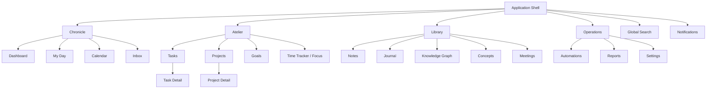

# Personal OS — Frontend Pages & Experience Specification
**Purpose:** Page-by-page direction for Antigravity and implementation agents  
**Product phase:** Productivity OS core, with AI capabilities introduced after dependable workflows exist

## 1. Frontend contract

This document describes what each page is for, its information hierarchy, primary actions, important states, and responsive behavior. It does not replace the product requirements, system design, backend/API specification, or security direction.

Rules:
- Build only pages and features approved by the active spec.
- Each page must have one primary user outcome.
- Page-level composition should be spacious and task-oriented.
- Reuse shell, tokens, and stable primitives; do not force every page into the same card layout.
- Keep domain logic out of UI components.
- All protected data access must follow server-side authorization and RLS.
- No mock data may be presented as live data in production.
- Do not add AI chat UI by default. Add AI surfaces only where an approved workflow benefits from them.

## 2. Global application shell

### Desktop shell
- Left sidebar: brand, grouped navigation, active route, account/workspace switcher.
- Top utility bar: breadcrumb/current page, global search, notification access, create/capture action, profile.
- Main area: route-specific content in a constrained max-width container.
- Sidebar should remain visually quiet; active route uses a subtle warm tint and accent, not a loud block.

### Mobile shell
- Compact header with page title, search access, and contextual action.
- Drawer or bottom navigation for primary destinations; secondary modules in “More”.
- Main content is single-column by default.
- Create/capture action remains reachable without covering page content.
- Menus, dialogs, and detail panes use mobile-appropriate sheets/drawers.

### Global behavior
- Breadcrumbs show hierarchy where meaningful, not redundant labels.
- Search supports keyboard invocation and clear empty/no-results/error states.
- Notifications show unread count only when nonzero.
- Create action opens a context-aware creation menu (Task, Note, Event, etc. only if supported).
- Preserve page state appropriately on navigation; avoid losing unsaved form changes.

## 3. Page inventory and descriptions

## 3.1 Dashboard
**Purpose:** Give a calm, high-level orientation and surface the next best productivity action.

**Hierarchy:**
1. Greeting/date and brief intention/context.
2. Primary action (e.g., start focus session or plan day), only when relevant.
3. Small set of summary metrics.
4. Current focus/task, if one is selected.
5. Today's chronological flow.
6. A short active-project list.
7. Quick capture or recent note as a secondary utility.

**Primary actions:** Start/stop focus session, open current task, plan day, quick capture, navigate to full list.

**Avoid:** All modules at once, too many metric tiles, multiple prominent calls to action, decorative charts, AI assistant as a giant default panel.

**States:** loading, no planned day, no current focus, empty project list, task/timeline failure.

**Responsive:** desktop can use a balanced 2-column lower content region; mobile is one column. Metrics may wrap to 2 columns only if legible.

## 3.2 My Day / Day Planner
**Purpose:** Plan and execute today's work in sequence.

**Hierarchy:** date navigation and day summary; focus/intention; agenda or time-block timeline; planned tasks; unplanned/overdue items with clear separation.

**Actions:** add/reorder/complete task, schedule or reschedule item, start focus, change day.

**Avoid:** duplicate display of the same task in several prominent panels without context.

**States:** unplanned day, all tasks complete, overdue tasks, schedule conflict, loading/error.

**Responsive:** timeline becomes a readable vertical flow; controls may move into menus on narrow screens.

## 3.3 Calendar
**Purpose:** Understand time commitments and plan around events.

**Hierarchy:** calendar navigation, view selector (month/week/day/agenda as approved), event grid/list, event detail/editor.

**Actions:** create/edit event, navigate date range, change view, open linked task/project.

**Rules:** time zone must be explicit in data behavior; drag-and-drop is optional and must be keyboard-accessible or have an equivalent edit action.

**States:** no events, loading, event save failure, conflict/invalid time.

**Responsive:** agenda/list is preferred on small screens; do not squeeze a desktop week grid into mobile.

## 3.4 Inbox
**Purpose:** Capture unprocessed inputs and turn them into actionable items.

**Hierarchy:** inbox count/summary, capture control, item list, selected item detail or processing panel.

**Actions:** capture, classify/convert to task/note/event when supported, archive, delete with confirmation as needed.

**States:** empty inbox with useful capture hint, processing, failed conversion, validation error.

**Responsive:** mobile uses list → detail navigation or a sheet; avoid split panes on narrow screens.

## 3.5 Tasks
**Purpose:** Manage actionable work clearly.

**Hierarchy:** page title and task creation, view/filter controls, task list grouped by relevant criteria (Today, Upcoming, Project, Status), optional detail panel.

**Task row content:** completion control, meaningful title, due date when present, project/context, priority/status only when helpful.

**Actions:** create/edit/complete, assign project, set due date/priority, filter/search, open details.

**Avoid:** every task row becoming a multi-badge metadata stack; excessive columns.

**States:** no tasks, no filter results, invalid task, save/delete failure, pending operation.

**Responsive:** list rows become compact but tappable; detail panel becomes a route or sheet.

## 3.6 Task detail / Create & Edit Task
**Purpose:** Create or inspect one task without overwhelming the user.

**Fields (only where in approved schema):** title, description, status, priority, due/scheduled date, project, goal, tags, dependencies.

**Actions:** save, complete, close/cancel; destructive actions clearly separated.

**Rules:** validate at boundary and display actionable field errors. Avoid large forms with every optional property expanded initially; use progressive disclosure.

## 3.7 Projects
**Purpose:** Track outcomes, workstreams, and project-level context.

**Hierarchy:** project title and status, concise project overview, progress/outcome, task list, milestones/notes as supported.

**Actions:** create project, edit metadata, open project tasks, update status, archive.

**Avoid:** arbitrary progress percentages if there is no defined calculation or user-set field. Progress must have an explicit meaning.

**States:** no projects, archived view, project with no tasks, error.

**Responsive:** overview and task list stack vertically; details use tabs/sections only when content justifies them.

## 3.8 Project detail
**Purpose:** Provide one project’s working context.

**Hierarchy:** project identity/status; objective and key dates; task overview; related notes/files/milestones if implemented.

**Actions:** add project task, update project, navigate related artifacts.

**Rules:** show only relevant sections. Do not create empty tabs just to imitate a large SaaS product.

## 3.9 Goals
**Purpose:** Connect long-term outcomes to measurable progress and supporting work.

**Hierarchy:** goal list or overview, goal title and time horizon, defined measure, progress/check-ins, linked projects/tasks if supported.

**Actions:** create/update goal, record check-in, inspect linked work.

**Rules:** progress must be computed from a documented measure or entered as a user check-in—not arbitrary decorative progress.

**States:** no goals, goal without check-ins, completed/paused goal, invalid metric.

## 3.10 Time Tracker / Focus
**Purpose:** Record time and protect focused work.

**Hierarchy:** active session (if running), start action, recent sessions, totals by day/task/project.

**Actions:** start, pause/resume, stop, link session to task/project, edit manual entry if approved.

**Rules:** timer state must be reliable across refreshes/devices according to backend spec. UI display must not be the authoritative time source.

**States:** no active session, active, paused, stop confirmation if needed, save failure, concurrent session conflict.

**Responsive:** timer controls remain prominent and reachable; details/list below.

## 3.11 Notes
**Purpose:** Capture and organize durable information.

**Hierarchy:** note list/search, categories/tags, selected note/editor.

**Actions:** create/edit, search, tag, link to project/task when supported.

**Rules:** autosave status must be explicit if autosave exists. Protect against data loss; show save failure and recovery state.

**States:** empty notes, no search results, unsaved, saving, saved, failed.

**Responsive:** use list/detail navigation or sheet; editor receives enough width and line length.

## 3.12 Journal
**Purpose:** Private reflection and daily record.

**Hierarchy:** date selector, writing surface, optional prompts/tags, entry history.

**Actions:** create/edit entry, navigate dates, search/archive if approved.

**Rules:** privacy expectations must be clear. Prompts are optional and never block writing.

**Responsive:** clean single-column editor; minimize distractions.

## 3.13 Knowledge Graph
**Purpose:** Explore relationships between knowledge concepts and linked records.

**Hierarchy:** graph canvas or accessible alternate list, search/filter, selected concept detail.

**Actions:** open node, navigate relationship, create/edit concept or relation if approved.

**Rules:** graph visualization is supplementary; provide keyboard and list-based alternative. Avoid rendering an unreadable “hairball” by default. Load relevant neighborhoods rather than all nodes.

**States:** empty graph, no matches, loading neighborhood, graph failure.

**Responsive:** mobile defaults to searchable list/detail; graph view is optional and simplified.

## 3.14 Concepts
**Purpose:** Maintain reusable concepts/topics independent of graph visualization.

**Hierarchy:** searchable concept list, concept detail, relationships/references.

**Actions:** create/edit concept, connect related items, navigate source records.

**Rules:** preserve relationship integrity; label relationship types clearly.

## 3.15 Meetings
**Purpose:** Organize meetings and their outcomes.

**Hierarchy:** upcoming/past meetings, meeting details, agenda, notes, action items (only as implemented).

**Actions:** create/edit meeting, record notes, link action items, navigate date.

**States:** no meetings, meeting without agenda, save error.

**Responsive:** meeting list on mobile; details in a route/sheet.

## 3.16 Content Studio / Content Calendar
**Purpose:** Plan content work and its schedule, if this module is included in the approved product scope.

**Hierarchy:** content calendar/list, content item status, detail/editor, linked campaign/project.

**Actions:** create/edit content item, change planned date/status, open related assets.

**Rules:** do not imply content is published to external platforms unless a real integration and confirmation flow exists. Publishing integration is a separate capability.

**States:** empty calendar, draft, scheduled, failed external action, disconnected integration.

## 3.17 Reports / Analytics
**Purpose:** Help the user understand productivity patterns and progress.

**Hierarchy:** selected reporting period, a small set of meaningful metrics, supporting trend/segmentation.

**Rules:** metrics require definitions, reliable source data, and clear time windows. No vanity metrics or charts without a decision use. Charts must have accessible textual summaries.

**States:** insufficient data, loading, data error, zero values.

**Responsive:** charts stack; labels remain readable; avoid tiny legends.

## 3.18 Automations
**Purpose:** Configure approved rule-based workflows.

**Hierarchy:** automation list, status, trigger/action summary, detail/edit flow, execution history.

**Actions:** create/edit/enable/disable, inspect run, retry if policy allows.

**Rules:** triggers/actions must be allowlisted, validated, permission-checked, and auditable. Show consequences and execution status. AI-generated automation is not enabled without approval.

**States:** no automations, disabled, running, failed, waiting, integration unavailable.

## 3.19 AI Assistant (later layer, not default core)
**Purpose:** Support approved productivity workflows with natural-language interaction and bounded tools.

**Principle:** AI is a contextual capability—not a replacement for normal navigation, task management, or deterministic functionality.

**Potential surfaces:** contextual “Ask” action on a task/project/note; command palette for approved actions; dedicated assistant workspace only if product evidence supports it.

**Requirements:** user-scoped context retrieval, tool allowlist, schema validation, permissions, confirmation for impactful actions, bounded execution, clear status, audit trail, and useful failure handling.

**Avoid:** interchangeable chatbot panels placed on every page; generic chat without workflow utility; claims that the agent completed an action when it did not.

## 3.20 Search
**Purpose:** Find tasks, notes, projects, events, and other supported records.

**Behavior:** keyboard shortcut, scoped/global search, result categories, empty and no-result states, loading/error.

**Rules:** respect user access controls and data ownership. Do not leak cross-user matches. Result previews should show useful context and navigate to the source.

## 3.21 Notifications
**Purpose:** Surface relevant reminders and execution outcomes without interruption overload.

**Hierarchy:** unread/recent items, notification content, timestamp, destination.

**Actions:** mark read, navigate to source, manage preferences.

**Rules:** notifications are actionable and relevant. Do not create repeated notifications for the same event without deduplication policy.

## 3.22 Settings
**Purpose:** Configure account, workspace, preferences, integrations, and privacy.

**Sections (only as implemented):** profile, appearance, locale/time zone, notifications, connected integrations, security/privacy, data export/delete.

**Rules:** organize into named sections; avoid one giant settings form. Explain irreversible actions and confirm them appropriately.

**Responsive:** section navigation becomes a select/list; forms are single-column.

## 3.23 Integrations
**Purpose:** Connect and manage external providers.

**Hierarchy:** connected/disconnected provider cards or list, permission scope summary, connection state, management detail.

**Actions:** connect via secure OAuth flow, disconnect, reauthorize.

**Rules:** credentials stay server-side; display only safe connection metadata. Explain requested scopes. Handle OAuth state and failure safely.

## 3.24 Files / Resources
**Purpose:** Browse and manage user-owned attachments/resources.

**Hierarchy:** list/grid, type/name/date, filters/search, detail or preview.

**Actions:** upload, open/download, rename/delete if approved.

**Rules:** private storage, authorization checks, size/type validation, signed URLs with short expiry. Avoid exposing storage paths or secrets.

## 4. Shared UI states and patterns

Every relevant page should implement:
- Loading
- Empty
- Populated
- Filtered no-results
- Validation error
- API/network error and retry
- Pending operation
- Success confirmation
- Unauthorized/forbidden
- Offline/connection state where supported

Use consistent toast/inline feedback. Toasts are for transient confirmation, not the only way to communicate critical failures.

## 5. Navigation map

## 6. Page-level implementation checklist

For each page spec:
1. State the page goal and primary action.
2. Confirm data contracts and API endpoints.
3. Define loading, empty, error, and success states.
4. Design desktop and mobile composition before implementation.
5. Reuse established primitives and tokens.
6. Implement semantics, keyboard, focus, and touch behavior.
7. Add tests for core interaction and authorization-relevant behavior.
8. Inspect the page at target viewport widths and realistic content lengths.
9. Run lint, typecheck, tests, and build according to the production direction.
10. Update this document when the behavior or page scope changes.

## 7. Scope control

The page inventory is a conceptual map of the product. It is **not** authorization to implement every module at once. Build in the sequence approved by the roadmap/specs. A page may be deferred, simplified, or omitted until its spec is active. Do not create empty routes or fake modules merely to make navigation look comprehensive.
