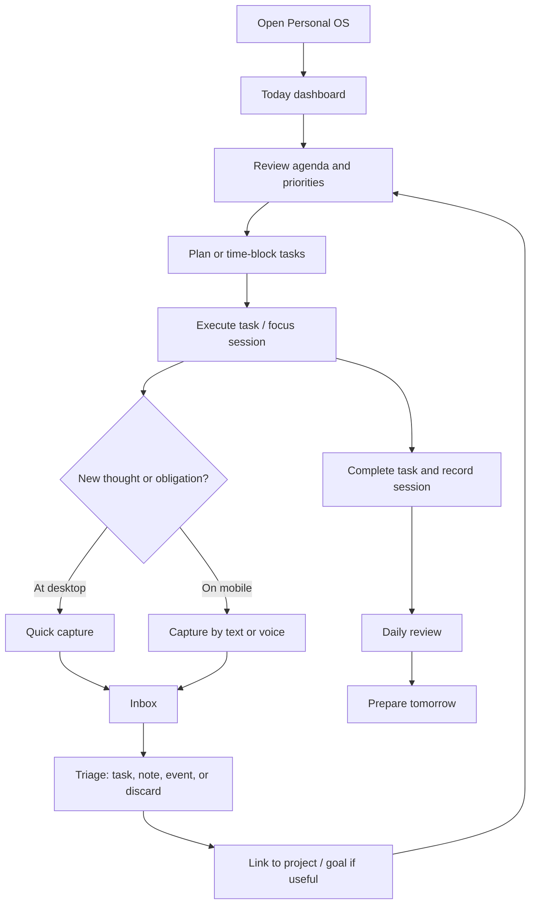
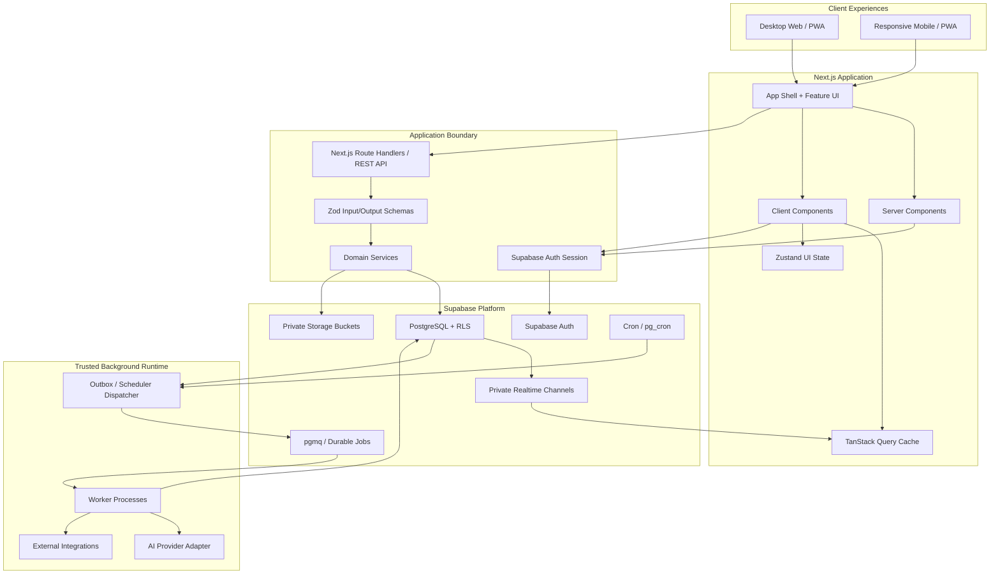
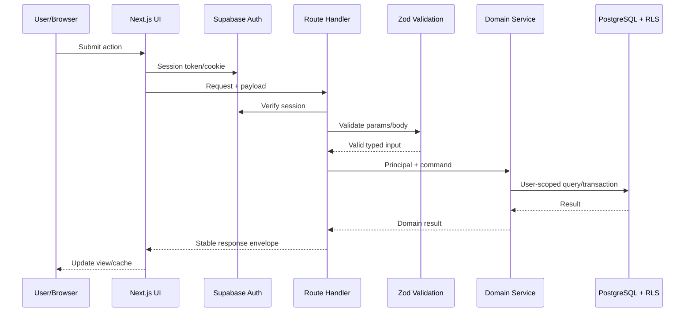
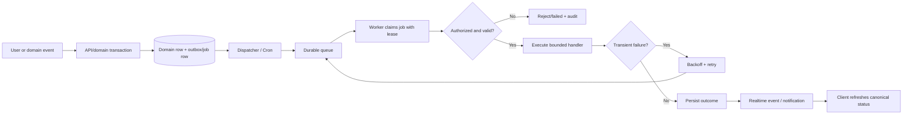
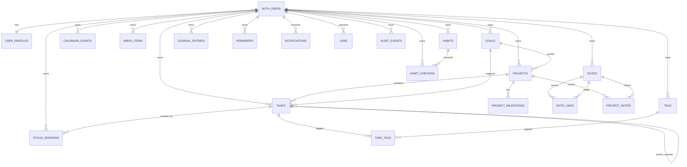
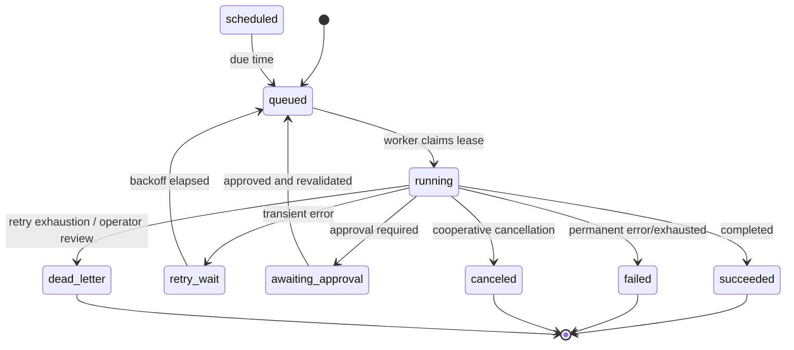
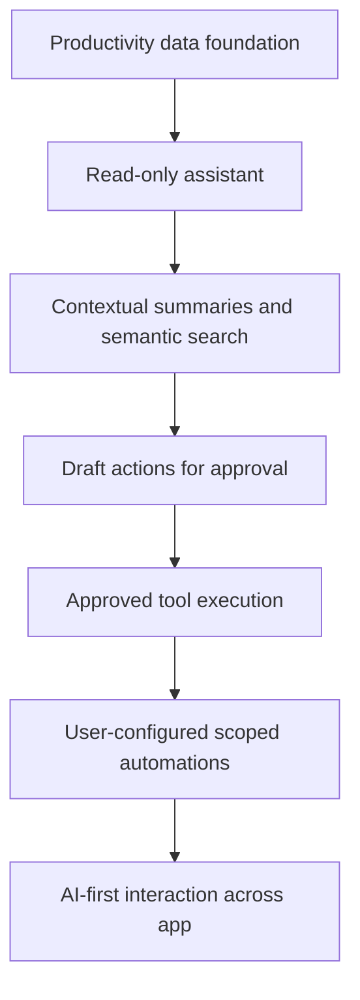
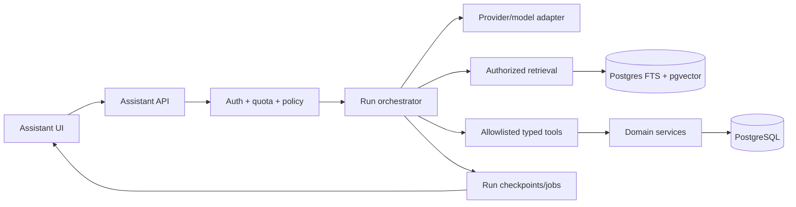
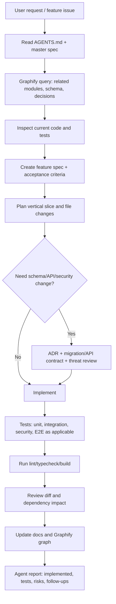

# Personal OS — Master System Design & Agent Development Specification

> **Document purpose:** Canonical product, system, data, security, execution, UX, and engineering context for building Personal OS with Antigravity and Graphify. This is an implementation-oriented specification intended for AI coding agents to crawl, chunk, search, and embed.
>
> **Status:** Architecture baseline / living specification  
> **Product phase:** Personal productivity OS first; progressively evolve into an AI-first personal operating system.  
> **Architecture principle:** Start with a secure modular monolith and add operational complexity only when measured requirements justify it.

---

## 0. How Agents Must Use This Specification

1. Read this document before implementing a feature. Find the relevant domain, model, API, UX, security, and execution sections.
2. Treat `MUST`, `MUST NOT`, `SHOULD`, and `MAY` as normative requirement keywords.
3. Do not invent new architectural conventions if this document already defines them.
4. If a requirement is ambiguous or conflicts with another requirement, stop and report the conflict with references. Do not silently choose.
5. Implement the smallest complete vertical slice: schema/migration → authorization → domain service → API → UI → tests → docs.
6. Update this specification or a linked feature spec when implementation changes a contract.
7. Do not add a dependency without explaining its role, overlap, bundle/runtime impact, and alternatives.
8. Never use privileged credentials in browser code. Never bypass RLS for convenience.
9. Keep domain logic out of UI components and route handlers. Route handlers are boundary adapters.
10. Agents must use globally installed skills when applicable, but first inspect skill instructions and verify the skill's relevance. Skills are helpers, not authority to override this specification or security policy.
11. Use Graphify to maintain and query the project knowledge graph (architecture entities, dependencies, decisions, modules, schemas, and workflows). Update graph artifacts after meaningful architecture or code changes.
12. Antigravity agents must work spec-first: plan, inspect existing code, propose changes, implement, test, review, and report. Avoid broad rewrites without explicit approval.

### Requirement IDs

Feature requirements should be labeled, where practical, as:
- `PRD-*`: product requirements
- `UX-*`: interaction and interface requirements
- `ARCH-*`: architecture requirements
- `DATA-*`: schema/data integrity requirements
- `SEC-*`: security requirements
- `EXEC-*`: execution/runtime requirements
- `API-*`: API contract requirements
- `TEST-*`: testing requirements

---

## 1. Product Vision and Definition

Personal OS is a private, cross-device productivity system that unifies an individual's work and personal life into a coherent system of tasks, projects, goals, schedule, notes, habits, focus sessions, journal, and captured information.

The product starts as a **personal productivity OS**. AI is introduced in progressive layers, becoming an AI-first interaction model only after the foundational data model, permissions, and user workflows are reliable.

### 1.1 Product pillars

1. **Capture:** Get tasks, thoughts, links, notes, and reminders out of the user's head quickly.
2. **Organize:** Convert captured information into tasks, projects, goals, events, notes, and knowledge.
3. **Plan:** Build a realistic daily and weekly plan around time, priorities, and commitments.
4. **Execute:** Work through tasks, focus sessions, and project milestones.
5. **Reflect:** Review outcomes, habits, time use, and personal progress.
6. **Connect:** Keep related information linked without forcing users into rigid workflows.
7. **Assist:** Add AI to search, summarize, recommend, plan, and eventually execute authorized actions.

### 1.2 Product principles

- Personal-first, not team collaboration-first.
- One coherent system; avoid disconnected feature silos.
- Desktop is the deep-work workspace; mobile is the capture-and-action companion.
- Progressive disclosure: advanced controls appear when needed.
- Fast capture should take seconds and should not require categorization.
- User data remains private by default.
- AI is optional and must not be required for core productivity.
- All AI actions must be bounded, permission-aware, explainable, and auditable.
- Offline behavior should prioritize safe capture and viewing of recently synced data; full offline conflict-free editing is not an initial requirement.
- Avoid gamification that pressures or shames users.
- Prefer predictable UX over novelty.

### 1.3 Initial target user and product stance

Primary user: an individual managing personal priorities and professional responsibilities (freelancer/entrepreneur is a useful first persona, but the product must not hard-code that persona).

Do not initially implement:
- Multi-tenant organization administration
- Complex team roles and collaborative editing
- Enterprise approval chains
- Billing/subscription platform
- Arbitrary user-authored code execution
- Fully autonomous AI agent with unrestricted access

These can be future extensions with explicit product and security review.

---

## 2. Product Scope and Release Phases

### Phase 1 — Productivity foundation (MVP)

- Authentication and user settings
- Home dashboard / Today view
- Inbox / quick capture
- Tasks, subtasks, priorities, due dates, status, tags
- Projects and milestones
- Calendar events and task scheduling/time blocks
- Focus timer and focus session history
- Notes and basic linking
- Habits and simple streak/consistency tracking
- Journal entries
- Search across core records
- Reminders and notification preferences
- Desktop and mobile responsive UX
- Basic analytics: completion, overdue, focus time, habit check-ins
- Secure API, RLS, audit for critical actions, tests

### Phase 2 — Integrated productivity

- Goals and goal milestones
- Weekly review and planning
- Rich notes (editor, backlinks, tags)
- Knowledge concepts and relationships
- Content planning module (optional personal/professional domain)
- More robust recurring tasks and events
- PWA installation, offline quick capture, push notifications
- User-defined dashboard layout
- Export and data portability

### Phase 3 — AI assistance layer

- AI assistant chat
- Natural-language task/note/event creation
- Semantic search over authorized personal data
- Context-aware summaries (day, project, note, review)
- Suggested daily plan with user approval
- Voice capture and transcription
- AI memory records with explicit controls
- AI job/run history, budgets, approval flow

### Phase 4 — AI-first workflows

- Assistant can orchestrate multiple bounded tools
- User-approved automations and schedules
- Trigger-condition-action builder
- Workflow preview and execution timeline
- Cross-module actions with checkpointing
- Integrations (calendar/email/task providers) by user opt-in
- Reusable agent workflows, evaluated and versioned

Phase gates are based on usability, correctness, security, and operational maturity—not merely feature count.

---

## 3. Desktop and Mobile User Experience

### 3.1 Desktop: primary workspace

Desktop is optimized for planning, organization, creation, detailed review, and complex operations.

Main surfaces:
- Persistent navigation sidebar
- Workspace/content region
- Optional contextual inspector or detail panel
- Command palette
- Global search
- Notification center
- User profile/settings menu

Desktop capabilities:
- Multi-column dashboard
- Dense task/project tables and board views
- Calendar day/week/month and time-block planning
- Rich note editing and backlinks
- Bulk operations and advanced filters
- Keyboard shortcuts
- Drag-and-drop where it improves planning
- Project detail with milestones, tasks, notes, and activity
- Analytics and review screens
- Automation editor and execution history in later phases

### 3.2 Mobile: companion application

Mobile is optimized for capture, checking status, quick actions, reminders, and contextual use.

Main navigation (initial proposal):
- Today
- Inbox
- Calendar
- Search/Assistant (AI layer later)
- More

Persistent quick capture action:
- Create task
- Capture note/idea
- Add event
- Voice capture (when implemented)

Mobile capabilities:
- One-handed operation and touch-sized targets
- Today agenda and top priorities
- Complete/snooze/reschedule task
- Quick note/voice capture
- Calendar agenda view
- Focus timer controls
- Habit check-ins
- Reminder notification actions
- Inbox triage
- Read-only/lightweight project overview
- Offline capture queue and sync status
- Deep links to record detail

Do not reproduce every desktop module at full fidelity on mobile. Rich knowledge graph editing, advanced analytics, complex automation building, and large bulk editing are desktop-first.

### 3.3 Responsive rules

- Design mobile-first breakpoints and test at narrow widths.
- Sidebar collapses to a drawer on mobile.
- Desktop tables become cards or simplified lists on mobile.
- Calendar defaults to agenda/list on mobile; week/day grid may be available.
- Detail panels become full-screen sheets or routes on mobile.
- Preserve context when navigating into and out of a record.
- Use accessible focus states, keyboard support, semantic landmarks, and contrast.
- Loading, empty, error, offline, and permission-denied states are required—not optional polish.

### 3.4 Daily usage journey



---

## 4. Information Architecture

### 4.1 Navigation model

Primary navigation:
1. Home / Today
2. Inbox
3. Tasks
4. Projects
5. Calendar
6. Goals
7. Notes / Knowledge
8. Habits
9. Journal
10. Focus
11. Reports / Reviews

Secondary/utility:
- Global search
- Command palette
- Notifications
- AI Assistant (Phase 3+)
- Automation Center (Phase 4)
- Settings
- Integrations
- Data export

Avoid showing every module as a primary nav item on small screens. Use a “More” destination and user-customizable navigation later.

### 4.2 Universal objects and cross-links

A task may be associated with:
- Project (optional)
- Goal (optional)
- Calendar time block (optional)
- Note/reference (optional)
- Habit (not directly; habit check-in is its own record)
- Focus session(s)
- Tags

A project may contain:
- Tasks
- Milestones
- Notes
- Goal association (optional)
- Project review/activity events

A note may link to:
- Tasks
- Projects
- Goals
- Other notes/concepts
- Journal entries (optional)

An event may reference:
- Task/project/meeting context
- External calendar connection (later)

Avoid polymorphic references without a clear integrity strategy. Where relationships are needed, use explicit nullable FKs or typed junction tables.

---

## 5. Feature Domain Specifications

### 5.1 Home / Today Dashboard

Purpose: answer “What matters today, and what should I do next?”

Sections (configurable later):
- Date and day summary
- Top priorities
- Today’s scheduled events/time blocks
- Tasks due today and overdue
- Active projects and next milestones
- Focus session quick start and current timer
- Habit check-ins
- Inbox count and quick capture
- Daily review prompt (optional)
- Notification/reminder summaries

Requirements:
- Dashboard should be personalized but not require a complex layout editor in MVP.
- Widgets link to canonical records; dashboard does not duplicate record data.
- Derived metrics must have documented definitions.
- Avoid arbitrary “productivity score” in MVP; metrics should be interpretable.

### 5.2 Inbox and Quick Capture

Purpose: frictionless collection before organization.

Capture types:
- Task candidate
- Note/idea
- Link
- Reminder candidate
- Text/voice transcript (voice phase)

Fields:
- Content/title
- Optional description/body
- Capture source (`desktop`, `mobile`, `voice`, `share_sheet`, `assistant`, `web_clip`)
- Created timestamp
- Triage status
- Optional attachment/reference

Triage actions:
- Convert to task
- Convert to note
- Create event/reminder
- Link to project/goal
- Archive
- Delete

Inbox should be fast, forgiving, and avoid mandatory metadata.

### 5.3 Tasks

Task properties:
- Title (required)
- Description (optional)
- Status: `inbox`, `todo`, `in_progress`, `blocked`, `completed`, `canceled`
- Priority: `none`, `low`, `medium`, `high`, `urgent`
- Due instant/date (optional)
- Scheduled start/end (optional)
- Estimate in minutes (optional)
- Actual duration derived from focus sessions (not client-editable aggregate)
- Parent task (optional; subtask)
- Project (optional)
- Goal (optional)
- Tags
- Sort/order key
- Completion timestamp
- Recurrence rule (optional, Phase 2)
- Created/updated timestamps

Rules:
- A completed task has `completed_at` set; non-completed tasks have it null.
- Subtasks cannot create cycles.
- Task start/end schedule must be valid (`end > start`).
- Completed/canceled tasks are excluded from active Today lists by default but remain searchable.
- Task state changes use domain service, not arbitrary status field assignment.
- Recurring tasks generate distinct task instances or occurrence records; do not mutate the historical completed instance into the next occurrence.
- Soft deletion may be used for recoverability, but retention and purge semantics must be documented.

### 5.4 Projects

Purpose: group work toward a deliverable or outcome.

Project properties:
- Name (required)
- Description
- Status: `planning`, `active`, `on_hold`, `completed`, `archived`
- Start date, target date
- Color/icon (presentation metadata)
- Goal link (optional)
- Project owner (user)
- Sort key

Project page:
- Summary and next milestone
- Task views (list/board)
- Milestones
- Notes/references
- Timeline
- Recent activity
- Review notes

Rules:
- Project completion must be deliberate; optionally warn if active tasks remain.
- Project status changes are validated.
- Project data must be owner-scoped.

### 5.5 Goals and milestones

Goal types:
- Outcome goal
- Metric goal
- Habit/behavior goal (association, not a substitute for habit records)

Goal properties:
- Name
- Description
- Status: `active`, `paused`, `completed`, `abandoned`
- Start/target date
- Metric unit/target/current (when applicable)
- Review cadence
- Parent goal (optional; cycle prohibited)

Milestones are explicit records with title, due date, status, and goal FK.

### 5.6 Calendar and time blocking

Calendar includes:
- User-created events
- Task time blocks
- Focus sessions (display layer)
- Reminders
- External calendar entries (later; read/write capability must be explicit)

Event properties:
- Title
- Start/end UTC instants
- Timezone ID for creation/display context
- All-day flag
- Location/link (optional)
- Event type
- Recurrence (later)
- Linked task/project (optional)
- Source (`internal`, `integration`)

Rules:
- End must be after start.
- All-day events use date semantics, not fake midnight UTC values.
- Store UTC instants and preserve timezone context for recurring local schedules.
- Calendar conflict indicators are advisory, not blocking by default.
- Scheduling a task does not automatically change its task status unless user-configured behavior says so.

### 5.7 Focus timer and time tracking

Purpose: support execution and measure time intentionally.

Focus session states:
- `running`
- `paused`
- `completed`
- `abandoned`

Fields:
- Task (optional)
- Started timestamp
- Ended timestamp
- Paused intervals or accumulated active seconds
- Session type (focus, break, custom)
- Planned duration
- Actual duration (derived)
- User notes (optional)

Rules:
- Server is authoritative for persisted session transitions; client timer is a display and optimistic UI.
- Only one active running session per user in MVP (enforced with partial unique index or transaction).
- A paused session remains active but not accruing active time.
- Client clock drift must not silently corrupt persisted duration; reconcile server timestamps and recorded pauses.
- Pause/resume/complete transitions are validated.
- Task actual time derives from completed sessions, not arbitrary client updates.

### 5.8 Notes and knowledge

MVP notes:
- Title
- Body (plain text/Markdown initially)
- Tags
- Optional links to task/project/goal
- Created/updated
- Archived flag

Phase 2:
- Rich text editor
- Backlinks
- Note-to-note relationships
- Concepts/knowledge graph
- Attachments and references

Content security:
- Treat imported and pasted content as untrusted.
- Render Markdown with raw HTML disabled by default.
- Sanitize any allowed rich HTML.
- Note content may contain sensitive personal information; do not expose in analytics logs.

### 5.9 Habits and check-ins

Habit properties:
- Name
- Description
- Schedule definition
- Target frequency
- Active/inactive
- Start/end date
- Optional goal association

Check-in:
- Habit FK
- Local calendar date
- Completion value or count
- Optional note

Constraints:
- Unique check-in per habit/user/date (unless habit semantics explicitly support multiple counts).
- Streak is derived from schedule and check-ins; do not persist as canonical truth without reconciliation.
- Missed days are not framed as failure; use neutral visual language.

### 5.10 Journal and reviews

Journal entry:
- Local date
- Content
- Mood/energy rating optional and user-controlled
- Tags
- Links to projects/goals/tasks optional

Unique policy: one daily entry per user/date by default; if multiple entries are supported, define their grouping.

Review records:
- Daily/weekly/monthly review type
- Period start/end
- Prompts and answers
- Summary/next actions
- Generated AI summary is marked as generated and editable

### 5.11 Search

Initial search: PostgreSQL full-text search with owner scope, filters, and ranking.

Searchable domains:
- Tasks
- Projects
- Notes
- Goals
- Events
- Inbox items
- Journal (opt-in setting)

Later: semantic search with pgvector.

Requirements:
- Enforce authorization and ownership in query path.
- Provide search result type, title/snippet, updated time, and deep link.
- Do not leak record existence through counts, error messages, or cross-user search.
- Respect user’s journal/AI-search privacy settings.

### 5.12 Reports and analytics

Initial metrics:
- Task completion count by period
- Overdue tasks
- Planned vs completed tasks (define methodology)
- Focus time by task/project/day
- Habit adherence by schedule
- Project status and milestone progress

Metric definitions must be documented, reproducible, and avoid unsupported causal claims. User may hide metrics.

### 5.13 Notifications and reminders

Channels:
- In-app notification center
- Web push (Phase 2)
- Email (optional integration)
- Mobile OS notifications via PWA/native wrapper, depending on platform capabilities

Notification fields:
- User
- Type
- Title/body (safe and privacy-aware)
- Related entity reference
- Scheduled/delivered/read timestamps
- Delivery channel
- State (`queued`, `sent`, `failed`, `read`, `dismissed`)

Requirements:
- User controls channel and content visibility.
- Do not put sensitive note body or private details into lock-screen notifications by default.
- Reminder jobs are durable and deduplicated by occurrence.

### 5.14 AI assistant and automations (future layer)

AI assistant capabilities, staged:
1. Read-only query: summarize day, retrieve authorized tasks/notes.
2. Draft: create a proposed task, note, or plan for user review.
3. Approved write: execute an explicitly confirmed action.
4. Configured automation: execute a narrowly scoped recurring/triggered action under a user grant.

AI may not:
- bypass authorization;
- self-grant tools;
- alter security policy;
- execute arbitrary shell/SQL/code;
- access another user's records;
- perform irreversible/high-impact actions without approval;
- treat retrieved documents or user-provided external content as instructions.

AI execution is specified in Section 13.

---

## 6. Recommended Technology Stack

The architecture baseline deliberately avoids overlapping frameworks.

### 6.1 Frontend

| Concern | Selected technology | Responsibility |
|---|---|---|
| App framework | Next.js App Router + React | Routing, rendering, layout, server/client boundaries |
| Language | TypeScript strict mode | Compile-time type safety |
| Styling | Tailwind CSS | Utility-first design system styling |
| UI primitives/components | shadcn/ui + Radix UI | Accessible, customizable component primitives |
| Icons | Lucide React | Consistent icons |
| Server data cache | TanStack Query | Client cache, query lifecycle, mutations, optimistic updates |
| Local UI state | Zustand | UI-only shared state (sidebar, palette, transient preferences) |
| Forms | React Hook Form | Form state and validation integration |
| Schema validation | Zod | Runtime boundary validation and typed schemas |
| Tables | TanStack Table | Headless tables, sorting, filtering, pagination |
| Charts | Recharts | Initial analytics visualizations |
| Rich text | TipTap (Phase 2) | Rich notes editor |
| Calendar | FullCalendar only if advanced scheduling requires it | Calendar rendering/interactions |
| Drag-and-drop | dnd-kit when board/time-block use cases ship | Accessible drag interactions |
| Command palette | cmdk | Keyboard-driven navigation/actions |
| Animation | Motion, restrained use | Micro-interactions |
| Virtualization | TanStack Virtual when lists become large | Avoid rendering huge lists |
| PWA | Serwist or current maintained Next-compatible solution, after offline requirements | Installation, cache strategy, offline shell |

**Do not add initially:** GraphQL/Apollo, Ant Design, Refine Core, Redux Toolkit, React Router, Socket.IO, multiple competing UI libraries. Add only after a concrete requirement and ADR.

### 6.2 Backend and platform

| Concern | Selected technology | Responsibility |
|---|---|---|
| Primary database | Supabase PostgreSQL | Relational canonical data |
| Authentication | Supabase Auth | Identity and sessions |
| Authorization | PostgreSQL RLS + server domain checks | User data isolation |
| Database client | Supabase JS; server user-scoped client | Access to Supabase data APIs |
| API layer | Next.js Route Handlers, REST `/api/v1` | Business operations, protected actions, stable contracts |
| DB migrations | Supabase CLI migrations (SQL) | Versioned schema, policies, indexes |
| ORM | Avoid ORM initially for core schema; use SQL migrations and typed Supabase client | Prevent duplicate schema authorities |
| Realtime | Supabase Realtime (private channels, selective subscriptions) | Live events/progress notifications |
| Vector search | pgvector, Phase 3 | Embeddings for semantic retrieval |
| File storage | Supabase Storage, private buckets | Attachments and generated exports |
| Scheduling | Supabase Cron/pg_cron | Trigger due work |
| Durable queue | pgmq or atomic jobs table, when async work is introduced | Durable job dispatch |
| Worker | Dedicated Node/TypeScript worker runtime/container when required | Long-running/CPU/provider jobs |
| AI providers | Provider adapter layer; no single provider lock-in | Model routing and capability abstraction |
| Observability | Structured logs, traces, metrics; provider-neutral instrumentation | Diagnosis and operations |
| Hosting | Next-compatible deployment; Supabase hosted backend | App delivery and managed DB |

### 6.3 Architectural choices and guardrails

- Use REST and Supabase JS, not GraphQL by default.
- Use Supabase directly for straightforward RLS-protected CRUD. Use Route Handlers for domain logic, side effects, integrations, AI, and operations requiring server policy.
- Use TanStack Query for client server-state; Zustand only for local UI state.
- Supabase Realtime is an event channel, not canonical persistence or a replacement for cache management.
- React Server Components by default; add client components only for interaction/browser APIs.
- Avoid Prisma/Drizzle until a specific need appears. SQL migrations are the authoritative schema.
- Do not split into microservices during MVP.
- Do not use in-memory timers or fire-and-forget promises for durable work.

---

## 7. High-Level System Architecture



### 7.1 Request flow



### 7.2 Async job flow



---

## 8. Codebase Structure

Recommended modular monolith:

```text
personal-os/
├── AGENTS.md
├── README.md
├── docs/
│   ├── master-system-design.md
│   ├── product/
│   ├── architecture/
│   ├── decisions/                 # ADRs
│   ├── feature-specs/
│   ├── api/
│   ├── data/
│   ├── security/
│   └── runbooks/
├── graphify/                      # Graphify-managed graph/artifacts (confirm plugin conventions)
├── app/
│   ├── (auth)/
│   ├── (app)/
│   │   ├── layout.tsx
│   │   ├── home/
│   │   ├── inbox/
│   │   ├── tasks/
│   │   ├── projects/
│   │   ├── calendar/
│   │   ├── goals/
│   │   ├── notes/
│   │   ├── habits/
│   │   ├── journal/
│   │   ├── focus/
│   │   ├── reports/
│   │   └── settings/
│   └── api/v1/
├── components/
│   ├── ui/                        # shadcn primitives
│   ├── shell/
│   ├── shared/
│   └── feature/                    # presentational feature components
├── features/
│   ├── auth/
│   ├── dashboard/
│   ├── inbox/
│   ├── tasks/
│   ├── projects/
│   ├── goals/
│   ├── calendar/
│   ├── focus/
│   ├── notes/
│   ├── habits/
│   ├── journal/
│   ├── search/
│   ├── notifications/
│   └── ai/                         # later
├── lib/
│   ├── supabase/
│   │   ├── browser.ts
│   │   ├── server.ts
│   │   └── privileged.ts           # server-only, restricted import
│   ├── query/
│   ├── validation/
│   ├── auth/
│   ├── observability/
│   └── utils/
├── server/
│   ├── domain/
│   ├── services/
│   ├── repositories/
│   ├── policies/
│   ├── jobs/
│   └── integrations/
├── worker/                         # separate runtime when introduced
├── supabase/
│   ├── migrations/
│   ├── seed.sql
│   └── tests/
└── tests/
    ├── unit/
    ├── integration/
    ├── e2e/
    └── security/
```

### 8.1 Module boundaries

Each feature module SHOULD contain:
- `schemas.ts`: Zod input/output schemas
- `types.ts`: domain types (avoid duplicate generated DB types)
- `queries.ts`: client query hooks or query options
- `mutations.ts`: mutation hooks
- `components/`: UI components
- `services.ts`: server-side domain operations (if applicable)
- `policy.ts`: feature authorization rules where nontrivial
- `tests/`

Rules:
- UI may call feature hooks; UI components should not embed raw SQL or privileged client calls.
- Route handlers parse/validate, authenticate, call domain service, serialize result.
- Domain services enforce state transitions, permissions, and transaction semantics.
- Repository functions perform persistence; avoid generic repositories that hide SQL semantics.
- Shared components must not import feature-specific business logic.
- Avoid circular module dependencies.

---

## 9. Database Design and Canonical Schema

PostgreSQL is the source of truth. Use UUID primary keys, explicit FKs, constraints, indexes, timestamps, and RLS. Names below are a logical baseline; migration review may refine naming but must preserve semantics.

### 9.1 Common conventions

- Primary key: `id uuid primary key default gen_random_uuid()`
- User ownership: `user_id uuid not null references auth.users(id) on delete cascade`
- Timestamp fields: `created_at timestamptz not null default now()`, `updated_at timestamptz not null default now()`
- Update `updated_at` through a database trigger or controlled mutation function.
- Store instants as `timestamptz`; local date-only semantics use `date`.
- Enum-like states: PostgreSQL enum or constrained text. Prefer constrained text if frequent evolution would make enum migrations costly; document chosen convention.
- Avoid JSONB for core relational properties. JSONB is for bounded metadata/configuration that genuinely varies.
- Never store derived values as canonical data unless necessary for performance and accompanied by reconciliation.
- Index common owner-scoped access patterns (`user_id`, status, due date, updated time).
- For all FKs, explicitly choose `ON DELETE` semantics.
- Apply RLS on all user-owned tables, including junction, vector, job, and storage metadata tables.

### 9.2 Core entity relationship diagram



### 9.3 Table contracts

#### `user_profiles`
- `user_id uuid PK FK auth.users(id) ON DELETE CASCADE`
- `display_name text`
- `avatar_path text`
- `timezone text not null default 'Asia/Kolkata'` (default may be derived at onboarding; never hard-code as all users' timezone)
- `locale text not null default 'en'`
- `week_start smallint not null default 1 check (week_start between 0 and 6)`
- `created_at`, `updated_at`
- RLS: owner only.

#### `user_preferences`
- `user_id uuid PK FK auth.users`
- `theme text check (theme in ('system','light','dark'))`
- `date_format text`
- `time_format text check (time_format in ('12h','24h'))`
- `default_view jsonb` (bounded UI preference)
- `notification_preferences jsonb` (validated keys only)
- `privacy_preferences jsonb` (validated keys only)
- timestamps
- RLS: owner only.

#### `tasks`
- `id uuid PK`
- `user_id uuid not null FK auth.users`
- `project_id uuid null FK projects`
- `goal_id uuid null FK goals`
- `parent_task_id uuid null FK tasks`
- `title text not null check (length(trim(title)) between 1 and 300)`
- `description text null`
- `status text not null check in ('inbox','todo','in_progress','blocked','completed','canceled')`
- `priority text not null default 'none' check in ('none','low','medium','high','urgent')`
- `due_at timestamptz null`
- `scheduled_start_at timestamptz null`
- `scheduled_end_at timestamptz null`
- `estimate_minutes integer null check (estimate_minutes between 1 and 10080)`
- `sort_key text not null` (or numeric fractional rank; specify consistent ordering strategy)
- `completed_at timestamptz null`
- `recurrence_rule text null` (Phase 2; validated recurrence subset)
- `archived_at timestamptz null`
- timestamps
- Check: `scheduled_end_at is null or scheduled_start_at is not null and scheduled_end_at > scheduled_start_at`
- Check: `(status = 'completed' and completed_at is not null) or (status <> 'completed' and completed_at is null)`
- FK consistency: project/goal/parent must belong to same `user_id`; enforce with composite FKs or domain transaction + RLS policy. Preferred robust design: add unique `(user_id,id)` on parent tables and use composite FKs `(user_id,project_id)` etc.
- Prevent parent cycles via domain service plus recursive validation/trigger if needed.
- Partial indexes: `(user_id,due_at)` where active; `(user_id,project_id,status)`; `(user_id,status,priority)`; parent lookup.

#### `projects`
- `id`, `user_id`
- `name text not null check length 1..200`
- `description text`
- `status text not null check in ('planning','active','on_hold','completed','archived')`
- `goal_id uuid null`
- `start_date date null`, `target_date date null`
- `color text null`, `icon text null` (presentation values validated)
- `sort_key text`
- `archived_at timestamptz`
- timestamps
- Check target date is not before start date if both supplied.
- Composite FK `(user_id,goal_id)` ensures goal ownership.

#### `project_milestones`
- `id`, `user_id`, `project_id`
- `title text not null`
- `due_date date null`
- `status text check in ('open','completed','canceled')`
- `completed_at timestamptz null`
- `sort_key`
- timestamps
- Composite FK to project `(user_id,project_id)`.

#### `goals`
- `id`, `user_id`
- `name text not null`
- `description text`
- `status text check in ('active','paused','completed','abandoned')`
- `goal_type text check in ('outcome','metric','behavior')`
- `start_date date`, `target_date date`
- `metric_unit text`, `target_value numeric`, `current_value numeric`
- `review_cadence text`
- `parent_goal_id uuid null`
- timestamps
- Composite FK for parent goal ownership; prevent cycles.
- Check target date not before start date.

#### `calendar_events`
- `id`, `user_id`
- `title text not null`
- `description text`
- `event_type text check in ('event','meeting','time_block','reminder')`
- `start_at timestamptz null`, `end_at timestamptz null`
- `start_date date null`, `end_date date null` for all-day event semantics
- `timezone text not null`
- `is_all_day boolean not null default false`
- `location text`, `url text`
- `task_id uuid null`, `project_id uuid null`
- `source text not null default 'internal' check in ('internal','integration')`
- `external_provider text`, `external_event_id text`
- `recurrence_rule text null` (Phase 2)
- timestamps
- Check timed event end > start; all-day fields use date range and valid exclusive/inclusive convention. Define all-day end semantics explicitly (recommended: exclusive end date).
- Composite FKs enforce same owner.
- Unique `(user_id,external_provider,external_event_id)` when external identifiers are non-null.

#### `notes`
- `id`, `user_id`
- `title text not null`
- `body text not null default ''`
- `body_format text not null check in ('markdown','rich_text')`
- `archived_at timestamptz null`
- `pinned_at timestamptz null`
- timestamps
- FTS index on title/body, scoped by user.

#### `note_links`
- `id`, `user_id`
- `source_note_id uuid`, `target_note_id uuid`
- `link_type text not null default 'related'`
- `created_at`
- Check source != target.
- Unique `(user_id,source_note_id,target_note_id,link_type)`.
- Composite FKs ensure both notes owned by same user.

#### `project_notes`
- `user_id`, `project_id`, `note_id`, `created_at`
- PK `(user_id,project_id,note_id)`
- Composite FKs.

#### `inbox_items`
- `id`, `user_id`
- `title text not null`
- `body text null`
- `item_type text check in ('task_candidate','note','link','reminder_candidate','other')`
- `capture_source text check in ('desktop','mobile','voice','share_sheet','assistant','web_clip','manual')`
- `status text check in ('unprocessed','triaged','archived')`
- `url text null`
- `converted_entity_type text null` and `converted_entity_id uuid null` only if polymorphic relation is consciously accepted; better maintain conversion references in explicit relation table if strict referential integrity required.
- `captured_at timestamptz not null default now()`
- timestamps
- Index `(user_id,status,captured_at desc)`.

#### `tags` and `task_tags`
`tags`:
- `id`, `user_id`, `name text not null`, `color text null`, timestamps
- Unique `(user_id,lower(name))` (implement functional unique index).

`task_tags`:
- `user_id`, `task_id`, `tag_id`, `created_at`
- PK `(user_id,task_id,tag_id)`
- Composite FKs to tasks and tags.

#### `habits`
- `id`, `user_id`
- `name text not null`
- `description text`
- `schedule jsonb not null` (validated schema; days/frequency/timezone)
- `target_count integer not null default 1 check > 0`
- `start_date date not null`
- `end_date date null`
- `goal_id uuid null`
- `is_active boolean not null default true`
- timestamps
- Composite FK to goal.

#### `habit_checkins`
- `id`, `user_id`, `habit_id`
- `local_date date not null`
- `count integer not null default 1 check (count >= 0)`
- `completed boolean not null default true`
- `note text null`
- `created_at`, `updated_at`
- Unique `(user_id,habit_id,local_date)` for single daily check-in semantics.
- Composite FK to habit.

#### `journal_entries`
- `id`, `user_id`
- `entry_date date not null`
- `title text null`
- `body text not null default ''`
- `mood smallint null check (mood between 1 and 5)` (optional; user opt-in)
- `energy smallint null check (energy between 1 and 5)` (optional)
- timestamps
- Unique `(user_id,entry_date)` if one entry/day; revise if multiple entries are desired.
- Journal text is sensitive content; exclude from logs and default analytics.

#### `focus_sessions`
- `id`, `user_id`, `task_id uuid null`
- `session_type text check in ('focus','break','custom')`
- `status text check in ('running','paused','completed','abandoned')`
- `started_at timestamptz not null`
- `ended_at timestamptz null`
- `planned_seconds integer null check > 0`
- `active_seconds integer not null default 0 check >= 0`
- `pause_intervals jsonb not null default '[]'` (bounded/validated) OR normalized `focus_session_pauses` table if robust audit is required
- `note text null`
- timestamps
- Check terminal states have end timestamp; active states have no end timestamp.
- Partial unique index: one running/paused active session per user.
- Composite FK task ownership.

#### `reminders`
- `id`, `user_id`
- `title text not null`
- `body text null`
- `scheduled_at timestamptz not null`
- `timezone text not null`
- `status text check in ('scheduled','sent','dismissed','canceled','failed')`
- `related_task_id uuid null`, `related_event_id uuid null`
- `dedupe_key text not null`
- timestamps
- Unique `(user_id,dedupe_key)`.
- Composite FKs.

#### `notifications`
- `id`, `user_id`
- `notification_type text not null`
- `title text not null`
- `body text null`
- `related_entity_type text null`, `related_entity_id uuid null` (polymorphic, not FK; treat as display link and reauthorize target on open)
- `status text check in ('queued','sent','read','dismissed','failed')`
- `scheduled_at timestamptz null`, `sent_at timestamptz null`, `read_at timestamptz null`
- `channel text check in ('in_app','web_push','email')`
- timestamps
- Index `(user_id,status,created_at desc)`.

#### `user_integrations` (later)
- `id`, `user_id`
- `provider text not null`
- `provider_account_id text`
- `scopes text[] not null`
- `status text check in ('connected','expired','revoked','error')`
- `secret_reference text not null` (reference to secure secret store; no raw tokens in ordinary table)
- `connected_at`, `last_synced_at`, timestamps
- Unique `(user_id,provider,provider_account_id)`.

#### `jobs` / `agent_runs` (async and AI phases)
- `id`, `user_id null` for system jobs only; require explicit actor/source when null
- `job_type text`, `job_version integer`
- `status text check in ('queued','scheduled','running','retry_wait','awaiting_approval','succeeded','failed','canceled','dead_letter')`
- `trigger_source text check in ('manual','schedule','event','webhook','agent','system')`
- `input_ref`/minimal validated `input_json`
- `result_ref`/safe `result_json`
- `idempotency_key`, `dedupe_key`
- `priority`, `scheduled_for`, `next_attempt_at`
- `attempt_count`, `max_attempts`
- `claimed_by`, `claim_token`, `lease_expires_at`, `heartbeat_at`
- `progress_stage`, `progress_percent`
- `cancel_requested_at`
- `last_error_code`, safe `last_error_message`
- `correlation_id`, `trace_id`
- `created_at`, `started_at`, `completed_at`
- Owner RLS for user job reads; worker privileged execution must re-check owner and action scope.
- Unique constraints for idempotency/dedupe scope.

#### `outbox_events`
- `id uuid PK`
- `user_id uuid null`
- `event_type text not null` (versioned name)
- `aggregate_type text not null`, `aggregate_id uuid not null`
- `payload jsonb not null` (minimal; avoid private content)
- `status text check in ('pending','published','failed')`
- `attempt_count integer not null default 0`
- `available_at timestamptz not null default now()`
- `published_at timestamptz null`
- `created_at`
- Index pending rows by status/available time.
- Outbox insert shares transaction with domain change.

#### `audit_events`
- `id uuid PK`
- `user_id uuid null`
- `actor_type text check in ('user','system','worker','admin')`
- `actor_id uuid null`
- `action text not null`
- `resource_type text not null`
- `resource_id uuid null`
- `outcome text check in ('success','denied','failure')`
- `metadata jsonb not null default '{}'` (strict allowlist; redact)
- `correlation_id text null`
- `created_at timestamptz not null default now()`
- Append-only; ordinary user cannot update/delete. Retention must be defined.

#### `embeddings` (Phase 3; pgvector)
- `id`, `user_id`
- `source_type text`, `source_id uuid`
- `chunk_index integer`
- `content_hash text`
- `embedding vector(<provider/model dimension>)`
- `metadata jsonb` limited to non-sensitive fields
- timestamps
- Unique `(user_id,source_type,source_id,chunk_index,model_id)`
- Access filters enforce owner before retrieval; avoid broad cross-user similarity search.
- Keep source content in canonical table or private storage; embedding row should reference it.

### 9.4 Relationship ownership integrity

For user-owned relations, preferred pattern:
- Parent table has `UNIQUE(user_id,id)`.
- Child table contains `user_id`.
- Composite FK `(user_id,parent_id) REFERENCES parent(user_id,id)`.
This prevents cross-owner association at the database level.

RLS is still required. Composite FK integrity is not authorization by itself.

### 9.5 Constraints and indexes checklist

- Every owner-scoped table: `user_id NOT NULL`, FK, RLS, owner index.
- State fields: explicit allowed values and domain transitions.
- Text: nonempty and bounded.
- Dates/times: valid ranges and timezone semantics.
- Uniqueness: user-scoped where appropriate.
- Soft deletion: clear query behavior and purge policy.
- Search: GIN FTS index with owner filter.
- Recurring occurrences: uniqueness per schedule/occurrence.
- Focus session: partial unique index for one active session/user.
- Jobs: dedupe/idempotency unique constraints, queue/lease indexes.
- Foreign keys: explicit delete behavior and composite owner constraints.

---

## 10. Security Architecture

Security is a core system invariant, not a feature.

### 10.1 Threats

- Cross-user IDOR/BOLA
- Unauthorized function/action access
- Service-role key leakage
- CSRF/XSS and unsafe rich text
- SSRF through URL imports/webhooks
- Prompt injection through retrieved/imported content
- Replay/duplicate side effects
- AI/provider quota abuse
- OAuth/webhook forgery
- Secrets or private content in logs/traces
- Malicious or oversized uploads

### 10.2 Authentication

- Supabase Auth is the identity authority.
- Derive user identity from verified session, never request-supplied `user_id`.
- Use secure HttpOnly SameSite cookies for server-managed sessions where applicable.
- Validate token/session with supported library; never hand-roll JWT validation.
- Rate-limit login, signup, recovery, and verification endpoints.
- Step-up authentication/recent session required for sensitive actions as product matures.

### 10.3 Authorization

- Deny by default.
- Every endpoint/action needs function authorization and resource authorization.
- RLS is enabled for all user data tables and private storage.
- Policies use `auth.uid()` and explicit ownership/membership checks.
- Separate SELECT/INSERT/UPDATE/DELETE policies where appropriate.
- UPDATE policy validates both row visibility and new row ownership (`USING` and `WITH CHECK`).
- Child records must be linked only to same-owner parents.
- RLS does not replace authorization before external side effects or worker tool calls.
- Automated tests must prove User A cannot read/write/search/export/execute against User B's data.

### 10.4 Supabase client boundaries

- Browser client: publishable key only; relies on RLS.
- Server user-scoped client: carries verified session; RLS remains active.
- Privileged service-role client: server-only, isolated module, limited use; never bundled to client.
- Never use service role for normal CRUD.
- For privileged operations, re-check user, resource ownership, action permission, and audit.
- Environment secrets are not committed, not `NEXT_PUBLIC_*`, and not returned to clients.
- Separate development, preview, production credentials; rotate on exposure.

### 10.5 API boundary

- Validate all bodies, params, queries, webhook payloads, and configuration using Zod.
- Reject unknown sensitive fields and mass assignment.
- Client cannot set owner ID, role, internal status, job attempts, audit fields, secrets, or server timestamps.
- Use parameterized SQL/query builder.
- Return stable error codes and correlation IDs, not stack traces or raw provider errors.
- Restrict CORS to known origins.
- Cookie-authenticated mutations use CSRF protections (SameSite + Origin/Referer checks and/or token).
- CSP, HTTPS/HSTS, frame restrictions, MIME sniffing protection, Referrer-Policy.
- Apply payload size and timeout limits.
- URL fetching defends SSRF: block loopback/private/link-local/reserved/metadata IPs, validate DNS and redirects, allow HTTPS only by default.

### 10.6 Storage security

- Private buckets by default.
- Storage RLS and database authorization required.
- Object path owner-scoped, e.g. `user_id/random_uuid`; path alone is not security.
- Signed URLs short-lived.
- Enforce file size, extension, actual MIME/content inspection; reject active/executable files by default.
- Isolate parsers with CPU/memory/time limits.
- No macros/scripts executed.
- Delete object and DB references through controlled lifecycle.

### 10.7 AI security (later phases)

- Model output is untrusted and cannot authorize operations.
- Retrieved notes/docs/transcripts/web content are data, not instructions.
- Retrieval filters enforce owner scope before model context.
- Tools are allowlisted, typed, and server-authorized.
- Read tools separate from side-effect tools.
- High-impact writes require user confirmation unless a narrow auditable grant exists.
- Agent cannot self-grant permission, access secrets, or expand scope.
- Limit tokens, tool steps, wall time, cost, concurrency, and egress.
- Prompt and result redaction; do not log full private prompts by default.
- Prompt injection defense is layered (scoping, filtering, allowlisted tools, confirmation, egress controls), not prompt-only.

### 10.8 Integrations and webhooks (later)

- OAuth state validation and PKCE where supported.
- Minimum scopes; encrypted secret store/reference; disconnect/revoke support.
- Verify webhook signature, timestamp, and replay protection.
- Validate webhook schema and enqueue durable processing.
- Outbound webhook URL validation against SSRF; sign requests; timeout and retry safely.

### 10.9 Audit, privacy, retention

Audit security-relevant actions: session/security events, integrations, export/delete, grants, job runs/cancel/replay, AI side effects, privileged operations.

Audit metadata must exclude credentials, signed URLs, raw private content, and full prompts. Define retention for application data, embeddings, queue payloads, logs, exports, and backups. User deletion must clean dependent rows, files, embeddings, integration secrets, and queued work, with documented backup retention.

### 10.10 Production security gates

- RLS tests for all tables/buckets
- Cross-user negative authorization tests
- Secret/dependency scanning in CI
- Static rule preventing privileged client imports in browser code
- CSP/security-header verification
- SSRF, webhook replay/signature, upload-abuse tests
- Rate-limit/quota tests
- Audit redaction tests
- Migration review verifies RLS/policies
- Incident playbook: revoke sessions/credentials, disable integrations, stop affected jobs, assess exposure, notify as required

---

## 11. API Contract

### 11.1 API conventions

Base path: `/api/v1`

- JSON requests/responses unless streaming or file upload.
- Authenticated endpoints require verified session.
- Use consistent response envelopes.
- Stable machine-readable error codes.
- Pagination bounded; default page size 25, maximum 100 (adjust by endpoint).
- Dates use ISO-8601; stored instants UTC.
- Mutating endpoints support `Idempotency-Key` when retry/side effects are possible.
- Version API behavior deliberately; do not silently break clients.

Success shape:

```json
{
  "data": {},
  "meta": {
    "requestId": "uuid"
  }
}
```

Paginated shape:

```json
{
  "data": [],
  "meta": {
    "requestId": "uuid",
    "nextCursor": "opaque-or-null"
  }
}
```

Error shape:

```json
{
  "error": {
    "code": "VALIDATION_ERROR",
    "message": "The request is invalid.",
    "details": {},
    "requestId": "uuid"
  }
}
```

Do not return sensitive details in `details`.

### 11.2 HTTP status conventions

- `200 OK`: read or successful update
- `201 Created`: resource created
- `202 Accepted`: durable job accepted
- `204 No Content`: delete or action with no body
- `400 Bad Request`: malformed request
- `401 Unauthorized`: missing/invalid session
- `403 Forbidden`: authenticated but not permitted
- `404 Not Found`: not found or not visible (avoid existence disclosure)
- `409 Conflict`: state conflict/idempotency mismatch
- `422 Unprocessable Entity`: schema/business rule violation
- `429 Too Many Requests`: rate limit/quota
- `500 Internal Server Error`: unexpected error with request ID
- `503 Service Unavailable`: dependency/circuit breaker

### 11.3 API endpoint inventory

#### Session/profile
- `GET /me`
- `PATCH /me/profile`
- `GET /me/preferences`
- `PATCH /me/preferences`
- `POST /me/export` → async job
- `DELETE /me/account` → guarded deletion workflow

#### Dashboard/day
- `GET /dashboard/today`
- `GET /dashboard/summary?date=`
- `GET /day-plan?date=`
- `PUT /day-plan/{date}` (plan/time-block changes)

#### Inbox
- `GET /inbox`
- `POST /inbox`
- `GET /inbox/{id}`
- `PATCH /inbox/{id}`
- `POST /inbox/{id}/triage`
- `POST /inbox/{id}/archive`
- `DELETE /inbox/{id}`

#### Tasks
- `GET /tasks`
- `POST /tasks`
- `GET /tasks/{id}`
- `PATCH /tasks/{id}`
- `POST /tasks/{id}/complete`
- `POST /tasks/{id}/reopen`
- `POST /tasks/{id}/reschedule`
- `POST /tasks/{id}/move`
- `POST /tasks/bulk-update`
- `DELETE /tasks/{id}`

#### Projects / milestones
- `GET /projects`
- `POST /projects`
- `GET /projects/{id}`
- `PATCH /projects/{id}`
- `POST /projects/{id}/archive`
- `GET /projects/{id}/tasks`
- `GET /projects/{id}/milestones`
- `POST /projects/{id}/milestones`
- `PATCH /milestones/{id}`
- `DELETE /milestones/{id}`

#### Goals
- `GET /goals`
- `POST /goals`
- `GET /goals/{id}`
- `PATCH /goals/{id}`
- `POST /goals/{id}/milestones`
- `POST /goals/{id}/review`

#### Calendar
- `GET /calendar/events?from=&to=`
- `POST /calendar/events`
- `GET /calendar/events/{id}`
- `PATCH /calendar/events/{id}`
- `DELETE /calendar/events/{id}`
- `POST /calendar/events/{id}/reschedule`

#### Focus
- `GET /focus/active`
- `POST /focus/sessions`
- `POST /focus/sessions/{id}/pause`
- `POST /focus/sessions/{id}/resume`
- `POST /focus/sessions/{id}/complete`
- `POST /focus/sessions/{id}/abandon`
- `GET /focus/history`

#### Notes / knowledge
- `GET /notes`
- `POST /notes`
- `GET /notes/{id}`
- `PATCH /notes/{id}`
- `POST /notes/{id}/archive`
- `GET /notes/{id}/backlinks` (Phase 2)
- `POST /notes/{id}/links` (Phase 2)
- `DELETE /notes/{id}/links/{linkId}` (Phase 2)

#### Habits
- `GET /habits`
- `POST /habits`
- `GET /habits/{id}`
- `PATCH /habits/{id}`
- `POST /habits/{id}/checkins`
- `GET /habits/{id}/checkins?from=&to=`
- `POST /habits/{id}/archive`

#### Journal/reviews
- `GET /journal?from=&to=`
- `POST /journal`
- `GET /journal/{id}`
- `PATCH /journal/{id}`
- `DELETE /journal/{id}`
- `GET /reviews`
- `POST /reviews`
- `PATCH /reviews/{id}`

#### Search
- `GET /search?q=&types=&cursor=`
- `POST /search/semantic` (Phase 3; protected, quota-bound)

#### Notifications/reminders
- `GET /notifications`
- `POST /notifications/{id}/read`
- `POST /notifications/{id}/dismiss`
- `GET /reminders`
- `POST /reminders`
- `PATCH /reminders/{id}`
- `POST /reminders/{id}/cancel`

#### Jobs/AI/automations (later)
- `POST /jobs`
- `GET /jobs/{id}`
- `POST /jobs/{id}/cancel`
- `GET /jobs/{id}/events` (SSE if supported)
- `POST /assistant/conversations`
- `GET /assistant/conversations`
- `POST /assistant/conversations/{id}/messages`
- `POST /assistant/runs/{id}/approve`
- `POST /assistant/runs/{id}/reject`
- `GET /automations`
- `POST /automations`
- `PATCH /automations/{id}`
- `POST /automations/{id}/enable`
- `POST /automations/{id}/disable`
- `GET /automations/{id}/runs`

### 11.4 API behavior and domain transitions

Use explicit command endpoints for important transitions rather than allowing arbitrary status edits:
- task complete/reopen
- focus pause/resume/complete
- project archive/complete
- reminder cancel
- job cancel/replay
- automation enable/disable

Domain service validates transition, ownership, preconditions, and writes audit/outbox event when required.

---

## 12. Frontend Data, Cache, and Realtime Model

### 12.1 Responsibilities

- **TanStack Query:** server-state cache, fetching, mutation lifecycle, optimistic updates, invalidation.
- **Zustand:** transient client UI state only.
- **Supabase Realtime:** authenticated change/event delivery.
- **PostgreSQL:** canonical persisted state.
- **Next.js Server Components:** initial render and server-only reads where appropriate.

### 12.2 Query key convention

Use stable feature-oriented query keys, e.g.:

```ts
['tasks', { status, projectId, dueRange }]
['task', taskId]
['projects', { status }]
['calendar', { from, to, timezone }]
['dashboard', 'today', localDate]
['focus', 'active']
['notes', { query, tags }]
```

Include all filter/scope inputs that change results. Never include secrets or raw private data in query keys.

### 12.3 Mutation pattern

1. Validate client form schema.
2. Submit command through API or RLS-protected Supabase query.
3. Server re-validates and authorizes.
4. Apply optimistic update only if rollback is reliable.
5. On success, update or invalidate relevant query keys.
6. On conflict/error, rollback and show a useful message.
7. Do not assume Realtime event order; reconcile against canonical server data.

### 12.4 Realtime policy

Use private channels and narrow subscriptions:
- Active focus session state
- Notifications
- Specific task/project changes when multi-device sync matters
- Job/agent progress in future phases

Avoid broad subscription to all user tables. Realtime is not durable; reconnect by refetching canonical records. Polling fallback for status views.

---

## 13. Execution and Background Work Model

Personal OS uses hybrid execution:
- Synchronous request/response for quick CRUD and bounded reads
- Database transactions for atomic invariants
- Durable async jobs for long-running or external operations
- Event-driven dispatch for domain changes
- Cron-triggered jobs for recurring work
- Bounded agent runs for future AI orchestration

### 13.1 Execution classes

| Class | Use |
|---|---|
| Synchronous API | Quick reads, CRUD, small state transitions |
| Transactional operation | Atomic multi-row changes |
| Async durable job | AI, import/export, indexing, publishing, provider sync |
| Scheduled execution | Reminders, recurrence, reviews |
| Event-driven | Task/note change, file upload, webhook |
| Agent execution | Multi-step model/tool workflows |
| Webhook ingress | Verified external callbacks |

### 13.2 Job lifecycle



### 13.3 Job requirements

- Persist job owner, type/version, status, input/result references, attempts, schedule, lease, heartbeat, cancellation, progress, correlation IDs.
- Worker atomically claims job; never select-then-update without locking.
- At-least-once delivery; handlers must be idempotent.
- Queue payload contains identifiers/minimal metadata, not secrets or entire private records.
- Retry transient failures with exponential backoff + jitter; honor `Retry-After`.
- Permanent failures are not retried until corrected.
- Define max attempts, max duration, concurrency, and dead-letter behavior.
- Cancellation is cooperative; completed external side effects cannot be rolled back.
- Manual replay requires authorization and audit.

### 13.4 Idempotency and side effects

- Support `Idempotency-Key` on retriable mutations.
- Store key, request hash, and result/job ID with user+operation scope.
- Reuse with different payload returns `409 Conflict`.
- Provider idempotency key used when supported.
- For uncertain provider timeout, reconcile provider state before retry.
- Side-effect ledger tracks `pending`, `confirmed`, `failed`, or `uncertain`.

### 13.5 Transactional outbox

Domain write and outbox event must be in same PostgreSQL transaction. Dispatcher publishes/requeues idempotently. Consumers deduplicate by event ID and tolerate duplicates/out-of-order delivery.

### 13.6 Schedules and recurrence

- Cron is scheduler, not long-task runtime.
- Persist timezone IANA ID; store actual instants UTC.
- Deduplicate each occurrence with unique key.
- Define missed-run policy: `skip`, `run_once`, or bounded `run_all`.
- Recurrence DST behavior must be explicit.
- Disabling schedule stops new runs; queued jobs re-check schedule status before side effect.

### 13.7 Agent execution (Phase 3/4)

Agent run:
1. Validate purpose, owner, scope, tools, budget.
2. Plan bounded steps.
3. Invoke model; validate typed tool request.
4. Authorize tool and resource at server.
5. Execute tool, checkpoint result.
6. Pause for approval when needed.
7. Revalidate approval and target state on resume.
8. Complete or stop on budget, deadline, cancellation, policy, or max steps.

No arbitrary shell, SQL, unrestricted network, filesystem, or secrets access. A sandboxed code execution environment, if ever added, requires isolated runtime, ephemeral filesystem, restricted egress, resource limits, and no application credentials.

---

## 14. AI Layer Roadmap and Model Abstraction

### 14.1 AI capability stages



### 14.2 AI architecture



### 14.3 Model/provider strategy

Do not hard-code a single provider into business logic. Define a provider adapter interface for:
- Text generation
- Structured output
- Embeddings
- Transcription (future)
- Streaming (optional)

Provider routing factors:
- Capability
- Quality requirement
- Latency
- Cost budget
- Privacy/data policy
- Availability

Keep model IDs/configuration in server-side configuration. Validate structured output using Zod. Model output is untrusted.

### 14.4 Retrieval and AI memory

- Canonical records remain in PostgreSQL.
- Embeddings are indexes/retrieval aids, not source of truth.
- Chunk source records with source ID, owner, model ID, content hash, and chunk index.
- Filter by owner and authorization before similarity search returns context.
- Re-index on source update/delete; remove vectors when source is deleted.
- AI memory must be inspectable, editable, and deletable by user.
- Distinguish durable user-approved preferences from inferred temporary context.
- Do not store sensitive attributes or content in memory without explicit policy and user control.

### 14.5 Tool permission tiers

- Tier 0: no tool; answer only.
- Tier 1: read-only user-scoped retrieval.
- Tier 2: create draft/proposal, no external side effect.
- Tier 3: reversible internal write with user confirmation or narrow user grant.
- Tier 4: external/irreversible/high-impact action; explicit confirmation required, with target/payload preview.

---

## 15. Offline, PWA, and Mobile Constraints

Initial mobile target: responsive web app; installable PWA only when offline/push requirements are proven.

Offline strategy:
- Cache application shell and static assets.
- Allow quick capture into a local pending queue.
- Display sync state clearly.
- Avoid offline mutation of complex relational entities in MVP.
- Queue IDs should be client-generated UUIDs where safe; server deduplicates.
- Conflict policy must be feature-specific (last-write-wins is not acceptable for all records).
- Do not cache private data on shared/public devices without user choice and secure storage considerations.
- Push notification support varies by platform/browser; treat as capability-dependent.
- Consider native wrapper only if platform requirements (widgets, reliable background behavior, native integrations) justify it.

---

## 16. Performance and Reliability Targets

These are initial engineering targets, to be validated by instrumentation:
- App shell interactive quickly on normal broadband/mobile network.
- Core CRUD endpoints p95 under 300–500 ms excluding cold starts and external providers.
- Dashboard payload bounded and composed from indexed queries; avoid N+1 query patterns.
- Search returns useful results under 1 second for expected MVP dataset.
- Client JS bundle should be kept lean; route-level code splitting and lazy loading for rich editor/charts/calendar.
- Realtime subscriptions are narrow and have reconnect/refetch behavior.
- Large lists use pagination and virtualization when needed.
- Avoid loading entire task/notes history into dashboard.
- External provider calls have explicit timeout, retry, and circuit breaker behavior.
- UI always communicates loading, empty, offline, failure, and stale states.
- Accessibility target: WCAG 2.2 AA where practical; keyboard and screen-reader support for core workflows.

---

## 17. Testing Strategy

### 17.1 Unit tests
- Domain transition rules
- Date/time and recurrence utilities
- Validation schemas
- Query-key generation
- Derived analytics calculations
- Permission helpers

### 17.2 Integration tests
- API route auth and validation
- PostgreSQL constraints and transactions
- RLS policy behavior
- Composite owner FK behavior
- Focus session active-session uniqueness
- Job claim, lease, retry, idempotency, outbox
- Storage policy
- Search authorization

### 17.3 E2E tests
Critical user flows:
- Sign in → Today dashboard
- Quick capture → inbox triage → task
- Create project → task association → complete task
- Schedule task → calendar display
- Start/pause/complete focus session
- Create/edit note → search
- Habit check-in → weekly view
- Mobile quick capture while offline → sync
- Reminder scheduled → notification status
- Cross-device update visible through authorized realtime

### 17.4 Security tests
- User A cannot read/write User B records via UUID substitution.
- User A cannot link task to User B project/goal.
- User A cannot read another user's job, file, embedding, or notification.
- User cannot forge `user_id`, role, status, or server-owned fields.
- Service role absent from client bundle.
- Webhook invalid signature/replay rejected.
- SSRF targets rejected.
- AI tool call without required permission rejected.
- Private content not present in logs.

### 17.5 CI gates
- TypeScript strict build
- ESLint/format
- Unit/integration tests
- Migration lint/review
- RLS policy test suite
- Secret/dependency scan
- E2E smoke suite for release
- Bundle analysis on meaningful dependency additions

---

## 18. Antigravity + Graphify Spec-Driven Workflow

### 18.1 Agent roles (logical, not necessarily separate agents)

- **Product/spec agent:** clarify requirement, acceptance criteria, UX flows, edge cases.
- **Architecture agent:** inspect boundaries, data contracts, ADR impact.
- **Implementation agent:** deliver scoped vertical slice.
- **Database/security agent:** review migrations, RLS, FK/constraints, sensitive operations.
- **Test agent:** add unit, integration, E2E, security tests.
- **Review agent:** inspect diff for regressions, dependency overlap, security and quality.
- **Graphify knowledge agent:** update and query graph relations for impacted components.

Agents can be orchestrated sequentially or in parallel when changes are independent. Avoid multiple agents editing the same files simultaneously.

### 18.2 Standard development loop



### 18.3 Feature spec template

Each feature spec should contain:
- Feature ID/name
- Goal/user value
- Scope and explicit non-scope
- Desktop behavior
- Mobile behavior
- User flows (Mermaid)
- Domain model changes
- API contract
- Authorization/RLS rules
- Execution class (sync/transaction/async/scheduled/event/agent)
- State transitions
- Validation and constraints
- Empty/loading/error/offline states
- Acceptance criteria
- Unit/integration/E2E/security test plan
- Dependencies and ADRs
- Telemetry/privacy considerations
- Rollout/rollback plan

### 18.4 Antigravity agent operating rules

- Start in planning mode for multi-file or architectural work.
- Inspect actual repository state; do not assume file names or existing implementations.
- Read relevant global skills before invoking their workflows.
- Do not claim tests passed unless commands were actually run and output inspected.
- Do not remove or rewrite working features without a stated reason and approval.
- Do not create speculative abstractions or generic frameworks.
- Use existing conventions; propose changes to conventions via ADR.
- Keep changes small and reviewable.
- Never commit secrets or real user data.
- Ask for approval before irreversible data migration, destructive commands, external side effects, or scope expansion.
- For dependency install: explain package, reason, alternatives, and whether overlapping package should be removed.
- If the agent cannot validate an assumption, mark it explicitly in report.

### 18.5 Graphify knowledge graph expectations

Graphify should connect:
- Product concepts ↔ feature specs
- Features ↔ routes/components
- Features ↔ database tables
- Tables ↔ constraints/indexes/RLS policies
- API endpoints ↔ domain services ↔ data tables
- Jobs/events ↔ handlers ↔ triggers
- ADRs ↔ affected components
- Tests ↔ requirements/features
- Dependencies ↔ libraries and why used

After meaningful changes:
1. Update graph inputs according to installed Graphify skill documentation.
2. Regenerate/update graph.
3. Query graph for affected downstream dependencies before refactors.
4. Include graph update and any graph inconsistency in implementation report.

Graphify's exact commands/file layout are to be determined from the globally installed skill; do not invent its invocation syntax.

### 18.6 Global skills policy

- Discover skills by relevance; do not activate every installed skill on every task.
- Read skill instructions before using its tool/workflow.
- Skills may help design, testing, accessibility, security, UI implementation, database work, and documentation.
- Use official documentation skills or sources for current library API details.
- Skill-generated output must be reviewed for project conventions, correctness, accessibility, and security.
- Skills do not override architecture requirements, authorization, or user approval boundaries.

---

## 19. Architecture Decision Records (ADRs)

Use short numbered ADRs in `docs/decisions/`. Suggested initial ADRs:

- `ADR-001`: Modular monolith over microservices for MVP
- `ADR-002`: Supabase PostgreSQL as canonical data store
- `ADR-003`: RLS + user-scoped server client authorization model
- `ADR-004`: Next.js App Router and REST API boundary
- `ADR-005`: shadcn/ui + Tailwind as primary UI system
- `ADR-006`: TanStack Query for server-state and Zustand for UI state
- `ADR-007`: SQL migrations as schema authority; no ORM initially
- `ADR-008`: Hybrid execution model; durable jobs for long-running work
- `ADR-009`: AI introduction staged behind user permission and budgets
- `ADR-010`: Mobile responsive PWA first; native wrapper only if justified

Each ADR contains: context, decision, alternatives, consequences, date/status, impacted modules, and migration/reversal path.

---

## 20. Implementation Sequence

### Milestone 0 — Foundation
- Repository structure and AGENTS.md
- Design tokens, app shell, route groups
- Supabase environments and migration workflow
- Auth, profile, preferences
- RLS helper/test patterns
- CI and observability basics

### Milestone 1 — Core productivity vertical slices
1. Inbox capture and triage
2. Tasks with state transitions and filters
3. Projects and task association
4. Today dashboard and derived summary
5. Calendar events/time blocks
6. Focus sessions
7. Notes and search
8. Habits and check-ins
9. Journal and daily review
10. Notifications/reminders

Each slice includes desktop and mobile UX, DB migration, authorization, tests, loading/empty/error states.

### Milestone 2 — Polish and reliability
- Responsive refinement
- Keyboard shortcuts and command palette
- Search and performance optimization
- Data export/delete
- Accessibility
- E2E/security suite
- PWA install/offline capture where validated

### Milestone 3 — AI assistance
- Provider adapter
- AI quotas and policies
- Read-only assistant
- Authorized retrieval
- Semantic search/pgvector
- Draft action proposal and approval
- Agent run history and checkpoints

### Milestone 4 — Automation and integrations
- Durable queue/worker
- Outbox and scheduled execution
- Automation definitions and run logs
- OAuth integrations and webhook handling
- Narrow user-configured grants
- Agent tool registry and approval flows

---

## 21. Constraints and Non-Goals

### Hard constraints
- PostgreSQL is canonical truth.
- All user-owned data must be owner-scoped and protected by RLS.
- AI cannot bypass domain services or security.
- Every async execution is durable, bounded, attributable, observable, and idempotent where possible.
- No secrets in browser bundle, logs, or repository.
- No arbitrary execution of user/AI-generated code in main application runtime.
- Keep modular monolith until evidence requires splitting.
- Desktop/mobile share domain data and core semantics.
- API/schema changes require tests and documentation.
- Prefer explicit domain types over `any`.
- TypeScript strict mode.
- Use UTC for stored instants and explicit IANA timezone for local schedules.

### Non-goals for initial MVP
- Teams/organization collaboration
- Public sharing of private data
- Autonomous agent with unrestricted tools
- Custom workflow scripting language
- Native iOS/Android apps
- Offline full relational editing with automatic conflict resolution
- GraphQL layer
- Multiple primary UI kits
- Microservices
- Billing

---

## 22. Open Decisions (Must Be Resolved Deliberately)

Do not silently decide these when implementation reaches them:

1. **Account model:** email/password, OAuth providers, or both?
2. **Data export:** JSON, CSV, Markdown archive, ZIP with files, or combination?
3. **Deletion policy:** soft delete duration and permanent purge timeline?
4. **Task recurrence:** RFC 5545 RRULE subset or custom recurrence model?
5. **Calendar:** internal calendar first or Google/Outlook integration in Phase 2?
6. **Offline capture:** local IndexedDB queue and sync/conflict rules?
7. **PWA push:** supported browser/platform target?
8. **Journal:** one entry/day or multiple?
9. **Focus timer:** single active session per user; confirm product rule.
10. **Notes editor:** Markdown-first or rich-text-first? Recommended Markdown MVP, TipTap Phase 2.
11. **AI provider policy:** which providers/data regions are permitted and what user consent is required?
12. **AI memory:** what is explicitly saved vs inferred, retention, user controls?
13. **Automation grants:** permission scopes, revocation, audit, and confirmation policy?
14. **Content Studio:** include in core product or optional extension?
15. **Mobile delivery:** responsive PWA sufficient or native wrapper needed later?
16. **Analytics:** local/private-only vs any product telemetry; define consent and retention.

---

## 23. Definition of Done

A feature is done only when:
- Product acceptance criteria are satisfied.
- Desktop and mobile behavior is defined and implemented for its scope.
- Data model and migration are correct and reversible where practical.
- RLS and authorization are tested.
- Validation and domain state transitions are server-enforced.
- Loading, empty, error, and relevant offline states exist.
- Unit/integration/E2E tests appropriate to risk pass.
- Accessibility and responsive checks are complete.
- Performance is acceptable and measured where meaningful.
- API and feature documentation updated.
- Graphify knowledge graph updated.
- No secrets, unnecessary dependencies, or unreviewed architecture changes.
- Agent reports files changed, tests run, outcomes, risks, and remaining work.

---

## 24. Concise Architecture Summary

Personal OS is a personal productivity platform built as a **Next.js + React + TypeScript modular monolith**, with **Tailwind + shadcn/ui** for the UI, **TanStack Query** for server-state, **Zustand** for local UI state, and **Supabase PostgreSQL/Auth/RLS/Storage/Realtime** as its managed backend foundation.

The core data model unifies tasks, projects, goals, events, notes, inbox, habits, journal, focus sessions, reminders, and notifications. PostgreSQL is canonical; strict owner-scoped constraints and RLS isolate each user's data. The API uses REST Route Handlers for business operations and protected side effects, while simple user-scoped CRUD may use Supabase's data API under RLS.

The runtime starts synchronous for fast interactions. Long-running, scheduled, event-driven, and AI work uses durable jobs, atomic claims/leases, retries, idempotency, transactional outbox, and auditable execution. AI evolves from read-only contextual assistance to user-approved tools and narrowly scoped automations. It never bypasses authorization.

Antigravity implements spec-first vertical slices with tests and reviews. Graphify maps requirements, features, code, schemas, APIs, execution handlers, ADRs, and tests so agents can retrieve architectural context and assess change impact. Global skills are used selectively and are subordinate to project specs and security policy.

**Build the reliable productivity foundation first. Add AI only after the data, workflows, permissions, and execution semantics are dependable.**
